# SVGCraft

A small in-browser SVG editor with no dependencies and no build step. It's
static files (`index.html`, `style.css`, the scripts in `src/`, `icons.js`
and `symbols-library.js`): open `index.html` directly, or serve the folder
(`npx serve .`) and host it anywhere static.

**Live:** <https://orthlieb.github.io/svgcraft/> (served by GitHub Pages
from the root of `main`; every push to `main` redeploys it).

[CENSUS.md](CENSUS.md) surveys 13 current editors and ranks features by
importance. It explains why the feature set below looks the way it does,
and what comes next.

## Workspace

SVGCraft is laid out like Photoshop: menus along the top, the tool's
options under them, tools down the left, panels down the right, and your
drawings in tabs in the middle. It edits on tablets and larger screens;
a phone gets a preview to look at drawings.

### On a phone

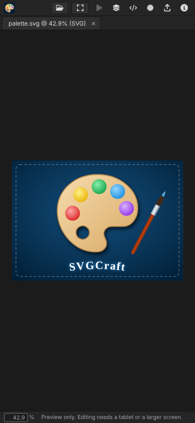

Look at, check and share SVGs on your phone. A phone gets a preview, not
the editor, so nothing you do there changes a drawing.

- Tap **Open** (the folder) to open an SVG. Each opens in a tab of its
  own; tap a tab to switch, or swipe along the tab bar for the next or
  previous drawing (while all the tabs fit).
- Drag to pan and pinch to zoom. Tap **Fit** (the four corners) to fit
  the drawing to the screen.
- Double-tap the canvas to zoom in on that spot (to 100%, or twice the fit
  for small drawings), and double-tap again to fit.

#### The phone toolbar

- **Play** (▶): plays the drawing's animations. ■, or a tap on the button,
  stops them. It's greyed out when nothing is animated.
- **Layers**: the layer list, to show and hide layers while you look (see
  below).
- **Text view** (`</>`): the SVG source full-screen, syntax-coloured, to
  read (long lines wrapped), search and **Copy** (or download). The same
  button, now a picture, goes back to the drawing.
- **Background**: the artwork on the checkerboard, white or black. Each
  tap moves to the next, and the button shows which it's on: a checkered
  circle, white ringed in black, or black ringed in white. It's
  remembered.
- **Share**: the phone's share sheet, with the SVG and a PNG of it. Where
  the browser can't share files, the SVG is downloaded instead.
- **Info** (ⓘ): the drawing's details (file, size, dimensions, layers,
  animations, fonts) and its metadata from File Info (title, author,
  description, keywords, date, copyright, licence and source, linked),
  read-only. **Help** opens this guide, and **About SVGCraft** is at the
  bottom.

#### Showing and hiding layers

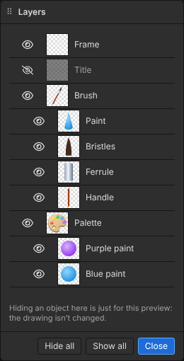

- Tap **Layers**, then a layer's eye to hide or show it. Each layer has a
  preview, always on the checkerboard as in the Layers panel.
- **Hide all** and **Show all** do every layer. Show all includes layers
  the file itself hides.
- Layers inside a hidden group are dimmed: they can't show until the group
  does.
- Only the preview changes. Nothing is saved, and switching tab or moving
  to a bigger screen shows the drawing as it is again.

#### Good to know

- A phone is a screen narrower than 768 px, or a phone held sideways.
- The editing tools, menus and panels are hidden there, and so is Undo.

### On a tablet

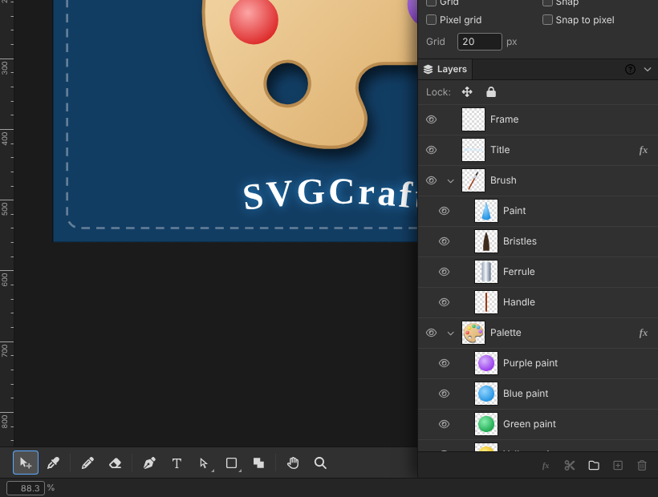

Edit on a tablet as on a computer. In landscape the layout is the same as
on a computer; in portrait it makes room for the canvas.

- The toolbar moves to the bottom of the screen.
- Tap the sliders button (top right) to slide the panels in from the
  right, and again to put them away.

#### Good to know

- This layout is for any window narrower than 1024 px, such as a tablet
  in portrait. The theme button and the Export label are hidden there to
  save room.

### Offline and as an app

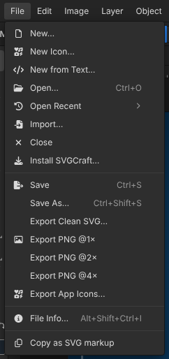

Use SVGCraft without a connection, or in a window of its own like any
other app.

1. Open SVGCraft from the web once. From then on it works offline too.
2. To install it: in Chrome and Edge, click the install icon in the
   address bar, or choose **File → Install SVGCraft…**. On an iPhone or
   iPad, tap **Share → Add to Home Screen**.
3. Open it from your apps. It opens in a window of its own.

#### Good to know

- On desktop Chrome and Edge, the installed app can be chosen to open
  `.svg` files.
- **Install SVGCraft…** only shows in the File menu when the browser
  offers to install it.
- Offline use works through a service worker, which keeps SVGCraft's
  files. Opened straight from disk (`file://`), none of this applies.

### The editor window

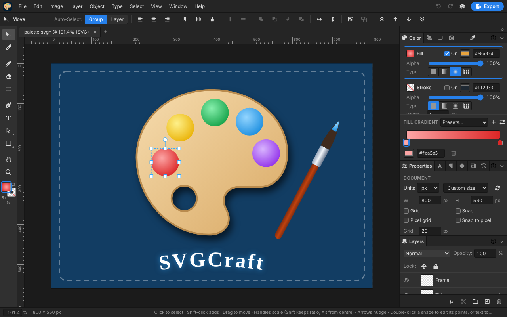

Find your way round the editor. From top to bottom:

- **Menu bar**: File, Edit, Image, Layer, Object, Type, Select, View,
  Window and Help (see [The menu bar](#the-menu-bar)).
- **Options bar**: the settings for the current tool (see
  [The options bar](#the-options-bar)).
- **Toolbar**, down the left (see [The toolbar](#the-toolbar)).
- **Document tabs** above the canvas, one per open drawing, showing the
  file name and zoom (see [Documents](#documents)).
- **Panels**, down the right (see [Docked panels](#docked-panels)).
- **Status bar**, along the bottom: an editable zoom field, the document
  size, and hints for the current tool.

### The menu bar

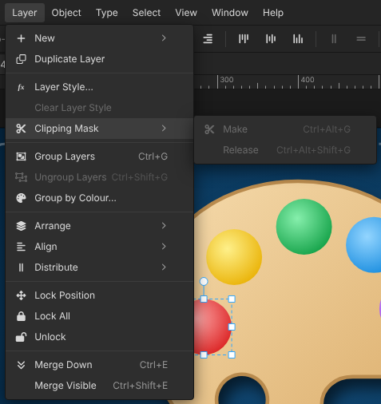

Find every command, in Photoshop's order.

- Click a menu to open it, then hover to switch between menus. The arrow
  keys move around too.
- An item that can't run on the current selection is greyed out. Its
  tooltip still shows, and its shortcut does nothing until it can run.

#### What needs what

- **Crop to Selection** needs a selection.
- A **Clipping Mask**, **Combine Shapes** or **Text on Path** needs two
  layers.
- **Distribute** needs three.

#### Good to know

- **Layer** holds what works on whole layers: New, Duplicate, Layer
  Style, Clipping Mask, Group, Arrange, Align, Lock and Merge.
- **Object** holds symbols and what works on shapes: Path, Combine Shapes
  and Flip.

### The options bar

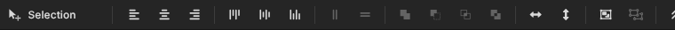

Change how the current tool works. The bar shows the settings for the
tool you have: stroke width and smoothing for the pencil, mode and size
for the eraser, or the point commands for Edit Points.

- Type a value, or drag a field's label sideways to scrub it. Shift
  scrubs 10× faster.

#### Auto-Select (Move tool)

- **Group**: a click on the canvas picks the whole top-level item.
- **Layer**: a click picks the exact shape under the cursor, even deep
  inside groups.

### The toolbar

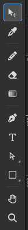

Pick a tool, and the colours it paints with.

- Click a tool to use it.
- A small corner mark means more tools share its button. Hold the button
  down, right-click it, Alt-click it or click the mark to pick another
  from its flyout.
- Click the fill or stroke chip (at the bottom) to make it the active
  paint. Click it again to pick a colour.
- Below the chips: swap fill and stroke (X), and "none".

#### Pointers

The pointer shows what a click will do, as in Photoshop:

- the Move tool's arrow and cross;
- Edit Points' white arrow;
- a cross or lasso for picking points, with + while Shift adds and −
  while Alt takes away;
- the pen's nib, with \* to start a path and o over its first point to
  close it;
- the pencil, the eyedropper and the type I-beam;
- the curved arrow on the rotate handle.

### Docked panels

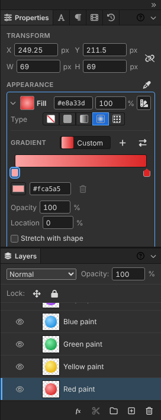

Keep the panels you use open beside the canvas, sized and folded the way
you like.

- Click a tab's icon to open it. The open tab also shows its name, and
  hovering any tab names it.
- Drag the divider under a group to resize it. Double-click the divider
  for the group's natural height, or focus it and use the arrow keys.
- Double-click a group's tab bar, or click the chevron at its end, to fold
  it to just its tabs. Layers then gets the room. Click a tab to open it
  again.
- Click **»** above the panels to shrink the column to a strip of icons,
  leaving more room for the canvas. Click **«** to bring the panels back.

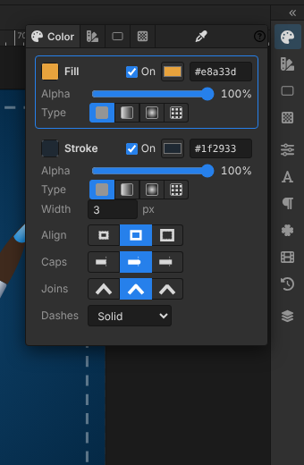

- With the panels as icons, click an icon to pop its panel out beside the
  strip. A click elsewhere, or Esc, puts it away.

#### The panels

- **Color**, **Swatches**, **Gradients** and **Patterns**: the fill and
  stroke, with the stroke's width, alignment, caps, joins and dashes.
- **Properties**, **Character**, **Paragraph**, **Symbols**, **Animation**
  and **History**. Properties has the shape's settings, the document size,
  and the grid and snap.
- **Layers**: see [Layers](#layers).

#### Good to know

- Each group keeps its height whatever its tab shows, as in Photoshop.
  Longer content scrolls inside it, so selecting something never shuffles
  the panels below.
- Layers takes the rest of the height and always keeps room.
- Heights and folded groups are remembered for your next visit.
  **Window → Reset Workspace** puts them back.

### Window menu

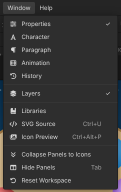

Open any panel by name, or put the workspace back as it was.

- Choose a panel to open it on its tab. This brings the panels back if
  Tab hid them, or pops it out of the icon strip.
- Choose a ticked panel to fold it away. A tick means it's showing.

#### Options

- **SVG Source** (Ctrl+U) and **Icon Preview** (Ctrl+Alt+P): open or close
  them (see [Split view](#split-view)).
- **Collapse Panels to Icons**: the icon strip.
- **Hide Panels** (Tab): hides the panels, and Tab brings them back.
- **Reset Workspace**: every panel open on its first tab, the icon strip
  and hiding undone, SVG Source and Icon Preview docked at the standard
  width, and dialogs back where they first open.

### Split view

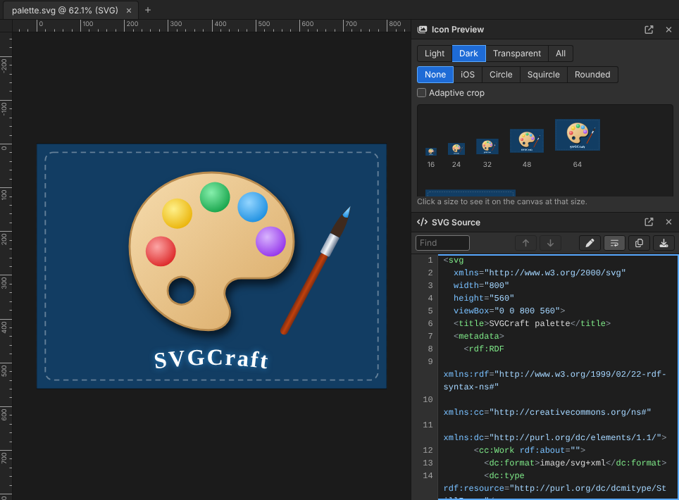

Watch the SVG source or the Icon Preview beside your drawing as you work.

1. Choose **Window → SVG Source** or **Window → Icon Preview**. It docks
   in a column beside the canvas.
2. Drag the divider at the column's left to resize it, or focus the
   divider and use the arrow keys.
3. With both open they stack, Icon Preview above SVG Source. Drag the
   divider between them to share the height.

#### Good to know

- The button in each one's title bar floats it as a window of its own,
  and docks it back.
- Whether each is docked, the column's width and the split are
  remembered.
- In windows narrower than 1024 px they float.

### Rulers, guides and smart guides

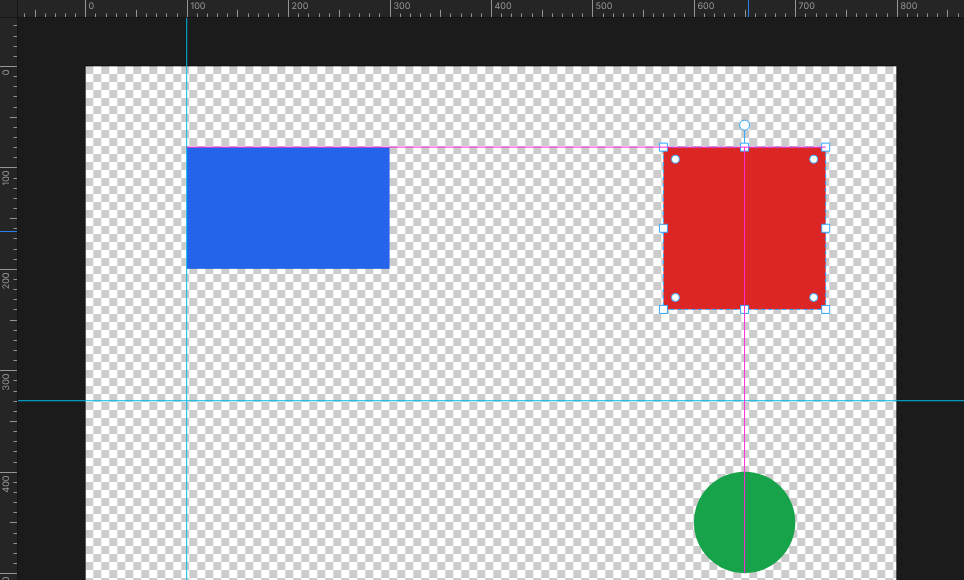

Line things up exactly: drag guides out of the rulers, and let shapes snap
to them and to each other.

1. Drag from the top or left ruler onto the canvas to make a guide.
2. Drag a guide with the Move tool to reposition it (Shift rounds to
   10 px), or drag it back onto a ruler to delete it.
3. Move or draw near a guide, and it snaps there. With **Smart Guides** on,
   it also snaps to the edges and centres of other objects and of the
   artboard, and magenta lines show what lined up.

#### Rulers

- Rulers run along the top and left, in document pixels. Their ticks
  re-scale with zoom, and a marker follows the cursor.
- **View → Rulers** (Ctrl+R) turns them off.

#### Guides

- **View → New Guide…** places a guide at an exact position.
- **Show Guides** (Ctrl+;), **Lock Guides** (Ctrl+Alt+;), **Snap to
  Guides** and **Clear Guides** are in the View menu too.
- Guides are part of undo.

#### Snapping

- A moved selection snaps by its left, centre or right edge, and by its
  top, middle or bottom.
- A guide or smart match within 6 screen pixels takes priority over the
  grid.
- Hold Ctrl/⌘ while dragging to skip snapping.

#### In the file

- Guides are saved in the file as invisible metadata (`data-sc-guides` on
  the root `<svg>`), which renders nothing.

### SVGCraft Help

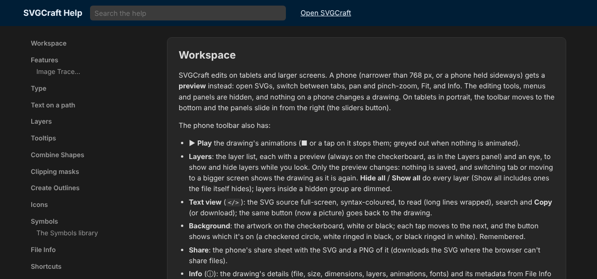

Look up how to do something, from anywhere in SVGCraft.

- Choose **Help → SVGCraft Help** (F1) to open this guide in its own tab,
  with every feature listed down the side and a search box.
- Click the **?** in a dialog's title bar, or a panel's tab bar, to open
  the topic for it.
- Press F1 with a dialog open to go to that dialog's topic.
- On a phone, **Info** has a **Help** button.

### Theme

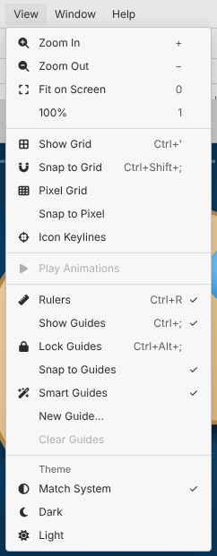

Choose a dark or light editor.

- Click the sun / moon button at the top right to switch between dark and
  light. (It's hidden in windows narrower than 1024 px.)
- Or choose **View → Match System**, **Dark** or **Light**.
- SVGCraft follows your system's setting until you choose, and remembers
  your choice.

## Features

### Import

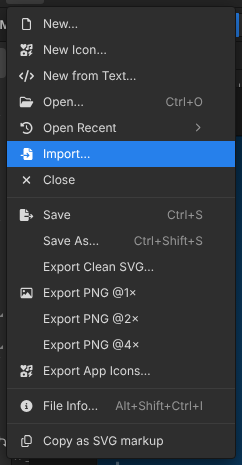

Bring artwork into SVGCraft: a whole drawing to edit, or an SVG or bitmap to
add to the one you're working on.

- **File → Open…** (Ctrl+O) → opens an SVG as a drawing of its own, in a
  new tab.
- **File → Import…** → places an SVG (as a group, scaled to fit) or a PNG,
  JPEG, WebP or GIF into the current drawing.
- Drag and drop files onto the window → the same, without the menu.
- **Edit → Paste** (Ctrl+V) → pastes SVG markup or an image from the
  clipboard. **Edit → Cut** and **Copy** put the selection on the clipboard
  as SVG.

#### Good to know

Every SVG that comes in (opened, imported, pasted, restored from this
browser, or in a library file) is sanitised with an allowlist, because it
goes into the editor's own page:

- Only SVG drawing elements are kept: no script, `foreignObject`,
  animation, or elements from other namespaces (such as HTML `<base>`,
  `<form>` or `<meta>`).
- Event handlers (`on*`) are removed.
- Links may only point inside the file, except image `data:` URLs and
  `http(s)` / `mailto` on `<a>`. They're checked as the browser reads them,
  so a hidden tab can't disguise `javascript:`.
- `url(…)` that would fetch from another server is dropped from styles and
  paint attributes, so opening a file never contacts anyone.
- `<style>` rules are baked into style attributes, so they can't restyle
  the editor. `<title>` and `<desc>` keep their text only.
- Root-level paint like `fill="none" stroke="currentColor"` (common in icon
  sets) is pushed down to the shapes, so it survives.

### Units and page size

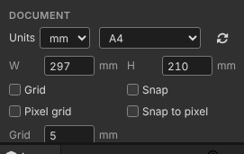

Work in millimetres, inches or points, or set the drawing to a standard
paper or screen size.

1. Open the **Properties** panel. The **Document** settings are at the
   bottom.
2. Pick the **Units** you want to see and type lengths in.
3. Pick a **Page size** from the menu beside Units to resize the artboard
   to it, or type a **W** and **H** of your own.
4. Click ↻ beside the page size to turn the page between portrait and
   landscape.

#### Settings

- **Units**: pixels, millimetres, centimetres, inches or points. They're
  used by the rulers, W and H, guide positions, the X/Y/W/H transform
  fields, Image and Canvas Size, the grid and the status bar. The grid takes
  a round size in the new units (5 mm, ¼ in…).
- **Page size**: A5, A4, A3, US Letter, Legal, Tabloid, business card,
  Full HD or square post. It also sets its units, and keeps the artboard's
  orientation.
- **W** and **H**: the artboard's size, anchored top-left.

#### Good to know

- Strokes, type and effects stay in pixels, as in Photoshop.
- Inside, the drawing is always in pixels (96 per inch), so changing units
  changes nothing but the numbers.
- A drawing in mm, cm, in or pt is saved with its real-world width and
  height (`width="210mm"`), so print, laser-cutter and plotter software
  know its size. The viewBox stays in pixels.
- Opening a file sized in real units shows it in those units. One drawn in
  other units (a viewBox in mm, say) is scaled to pixels, keeping its real
  size. Plain pixel sizes are left as they were.

### Image Trace…

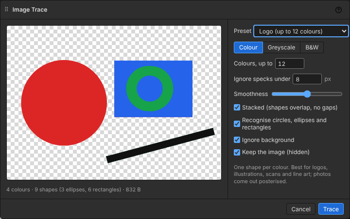

Turn a bitmap (a logo, icon, scan or line drawing) into vector shapes you
can edit.

1. Place the image (File → Import…, or drop it on the canvas) and select it.
2. Choose **Image → Image Trace…**.
3. Pick the **Preset** closest to your image, then adjust the settings while
   you watch the preview. The line under the preview gives the result's
   colours, shapes and size.
4. Click **Trace**. Each colour becomes its own layer in an "Image Trace"
   group, named like "Colour #2563eb · 34%".

#### Settings

- **Preset**: Logo (up to 12 colours, background left out), Illustration
  (16), Photo (24, posterised) or Sketch (black and white). Changing a
  setting below switches it to Custom.
- **Colour / Greyscale / B&W**: trace in colour, in greys, or in pure black
  and white at a **Threshold** you set.
- **Colours, up to**: a maximum. Colours that look the same merge, so a
  flat logo keeps exactly the colours it has.
- **Ignore specks under**: drops shapes smaller than this (noise, JPEG
  artefacts).
- **Smoothness**: how much outlines are smoothed into curves. 0 gives
  pixel-exact polygons; real corners stay sharp at any setting.
- **Stacked** (on by default): the largest colour goes at the bottom and
  each layer also covers every colour above it, so the layers overlap and
  no hairline gaps show. Turn it off for shapes that just touch, each only
  its own colour.
- **Recognise circles, ellipses and rectangles** (on by default): an
  outline within about a pixel of one becomes a true ellipse or a rectangle
  (with rounded corners when they fit better). Blobs under 12 px aren't
  taken for boxes.
- **Ignore background**: leaves out the colour round the edge of the image,
  where it touches the edge.
- **Keep the image (hidden)**: keeps the original under the trace, hidden,
  instead of replacing it.

#### Good to know

- Best for logos, icons, illustrations, scans and line art. Photos come out
  posterised.
- Each colour is taken from the solid inside of its areas, not their
  blended edges, so flat colours come out exact, and thin slivers of
  in-between colour along anti-aliased edges fold into their neighbours.
- It reduces the image to a few colours (k-means in Lab, so similar-looking
  colours group together), traces each colour's outline and fits curves to
  it. Images are traced at 400–1000 px on the long side, in a background
  thread, so the page doesn't stall.

### Image Size…

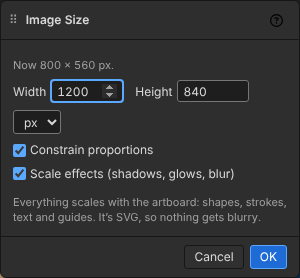

Make the whole drawing bigger or smaller: the artboard and everything on
it.

1. Choose **Image → Image Size…** (Ctrl+Alt+I).
2. Type a new **Width** or **Height**, in the document's units or in
   percent.
3. Click **OK**. It's one undo step.

#### Settings

- **Constrain proportions**: change the width and the height follows, and
  the other way round.
- **Scale effects** (on by default, Photoshop's Scale Styles): scales
  layer-effect distances and sizes too (shadow, glow, blur).

#### Good to know

- It's SVG, so nothing is resampled or blurred.
- Each top-level layer gets the scale on top of its transform, so strokes,
  text, patterns and gradients scale with the shapes. Guides scale too.
- Animation distances always follow the art.

### Canvas Size…

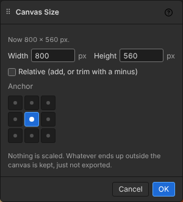

Add room round the drawing, or trim it, without scaling anything.

1. Choose **Image → Canvas Size…** (Ctrl+Alt+C).
2. Type a new **Width** and **Height**.
3. Click an **Anchor** square for the part that stays put.
4. Click **OK**.

#### Settings

- **Relative**: the numbers are added to the current size (or trimmed with
  a minus) instead of replacing it.
- **Anchor**: the centre grows or trims every side equally. A corner or an
  edge keeps that side fixed.

#### Good to know

- Content and guides shift by whole pixels and the view follows, so nothing
  jumps on screen.
- Whatever ends up outside the artboard is kept, just not exported.
- The **W** and **H** in Properties → Document also resize the artboard,
  anchored top-left.

### Grayscale and black & white

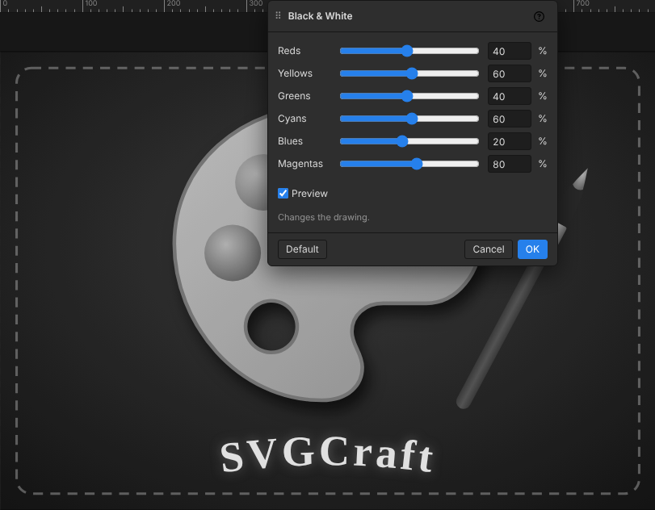

Turn a drawing, or just some layers, grey or pure black and white, as in
Photoshop. The colours themselves change, so the saved SVG really is grey.

1. Select the layers to change, or select nothing to change the whole
   drawing.
2. Choose one from the **Image** menu (below).
3. In a dialog, adjust it while the drawing previews, then click **OK**.

#### Options

- **Image → Adjustments → Desaturate** (Shift+Ctrl+U): every colour to the
  grey of the same lightness. No dialog.
- **Image → Adjustments → Black & White…** (Alt+Shift+Ctrl+B): Photoshop's
  six hue sliders (Reds, Yellows, Greens, Cyans, Blues, Magentas) and its
  defaults, previewed live. **Default** puts the sliders back.
- **Image → Adjustments → Threshold…**: pure black and white, split at a
  **Level** you set, previewed live.
- **Image → Mode → Grayscale**: the brightness the eye sees. No dialog.

#### Good to know

- They change fills, strokes, gradient stops, patterns, symbols and markers
  in use, Layer Style colours and embedded images, pixel by pixel.
- A gradient, pattern or symbol shared with layers outside the selection
  gets a copy of its own first, so only the selection changes.
- Each is one undo step.
- Layers locked against all edits, and linked (not embedded) images, are
  left as they are.

### Crop

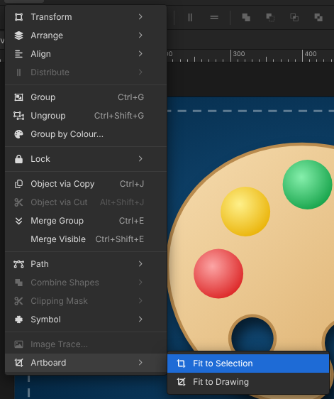

Fit the artboard tightly round your artwork, with no empty margin.

- **Image → Crop to Selection** → the artboard fits round the selected
  layers.
- **Image → Crop to Drawing** → the artboard fits round everything visible.

#### Good to know

- The box is rounded out to whole pixels, and it's what's actually painted,
  so nothing is shaved off. Stroke width and position (Center, Inside,
  Outside), mitre tips at sharp corners (up to the mitre limit), square and
  round caps, round joins and effects (drop shadow, outer glow, blur) all
  count, including on rotated and scaled layers.
- Hidden layers don't count.
- The drawing and the guides shift so the artboard still starts at 0, 0,
  and nothing moves on screen.
- Anything left outside the artboard is kept, but it isn't exported.
- Define Pattern and Copy as SVG frame the selection the same way.

### Select menu

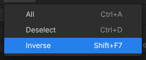

Select everything, nothing, or everything you haven't selected.

- **Select → All** (Ctrl+A) → selects every layer.
- **Select → Deselect** (Ctrl+D, or Esc) → selects nothing.
- **Select → Inverse** (Shift+F7, or Ctrl+Shift+I where the browser allows
  it) → selects every visible layer that wasn't selected.

#### Good to know

- If the selection includes a shape inside a group, Inverse works with
  individual shapes. Otherwise it works with top-level layers.

### History panel

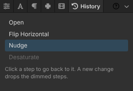

Go back to any earlier point in your work, as in Photoshop.

1. Open the panel with **Window → History**.
2. Click a step to go back to it. The steps after it dim.
3. Redo brings dimmed steps back, until a new change replaces them.

#### Good to know

- It lists every step since the drawing was opened.
- Each step is named by what made it: the menu command or shortcut, the
  tool you dragged with, or the panel control you changed.

### Documents

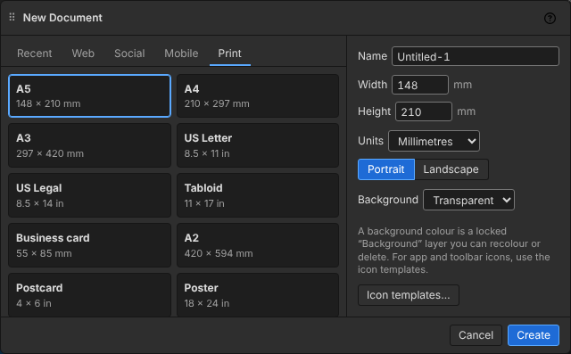

Start a new drawing at the size you need: a screen, a social post, a phone
or a sheet of paper.

1. Choose **File → New…**, or click **+** in the tab bar.
2. Pick a category and a preset, or type a **Width** and **Height** in any
   **Units**.
3. Set the **Name**, the orientation (**Portrait** or **Landscape**) and the
   **Background**.
4. Click **Create** (or press Enter, or double-click a preset). The drawing
   opens in a new tab.

Every open drawing gets a tab, as in Photoshop: see
[Open, close and switch tabs](#open-close-and-switch-tabs),
[Save and Save As](#save-and-save-as) and [Export](#export).

#### Presets

- **Recent**: the last five sizes you made.
- **Web**: common screen and ad sizes.
- **Social**: Instagram, stories, X, link previews, YouTube and LinkedIn.
- **Mobile**: iPhone, Android, iPad and Apple Watch.
- **Print**: A5–A2, US Letter, Legal, Tabloid, business card, postcard and
  poster.

#### Settings

- **Background**: Transparent, or a White, Black or custom colour. A colour
  becomes a "Background" layer at the bottom, locked in place as in
  Photoshop. Recolour it, or unlock and delete it.
- **Icon templates…**: switches to New Icon, for app and toolbar icons.

#### Good to know

- The dialog remembers your last settings.

### Open, close and switch tabs

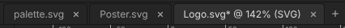

Work on several drawings at once, each in its own tab.

- **File → Open…** (Ctrl+O) → the file opens in a tab of its own. An
  untouched Untitled tab is reused.
- Click a tab → switch to that drawing. Each tab keeps its own drawing, undo
  history and zoom.
- Click a tab's ✕, middle-click it, or choose **File → Close** → closes the
  drawing. If it has unsaved changes, you're asked first.
- A `*` after the name → the drawing differs from the version last opened
  or saved.

#### Good to know

- **Save** (Ctrl+S) clears the `*`, as does the Export download. Undoing
  back to the saved version clears it too. PNG export doesn't count as
  saving.
- A drawing opens fitted to the window. It stays fitted while the canvas
  changes size (a pane docking, panels folding, the window resized, a phone
  turned) until you zoom or pan it yourself. A fitted drawing comes back
  fitted, whatever size the window is then.
- Closing the last tab leaves a blank workspace, as in Photoshop. Only New,
  Open (or dropping a file on it) and the view settings work until a
  drawing is open, and it stays blank after a reload.

### Save and Save As

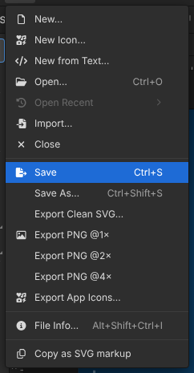

Keep your drawing as an SVG file that reopens with everything editable.

- **File → Save** (Ctrl+S) → saves the drawing. A new drawing asks where to
  save it the first time.
- **File → Save As…** (Ctrl+Shift+S) → saves to a new file, and carries on
  there.

#### Good to know

- In Chrome, Edge and other Chromium browsers, a drawing opened from a file
  (File → Open, dropped on the window, or opened with the installed app)
  saves straight back to that file. The browser asks once a session before
  letting the page change it.
- The link to the file is kept with the drawing in this browser, so Save
  still goes back to it after a reload.
- Browsers that can't write to files (Firefox, Safari, phones) download the
  SVG instead. There the menu says **Download SVG**, and Save As… isn't
  shown.

#### Kept in this browser

- All open drawings are kept in this browser (IndexedDB) as they change.
  A reload or a later visit brings back the same tabs, the same `*` marks
  and the same view.
- Keeping waits for a pause in your changes, but closing or reloading the
  page keeps them at once, so even the last change survives.
- The browser's copy is per browser and per machine: Save to keep a file.
- A drawing autosaved by an older version of SVGCraft is brought over as a
  tab.

### Export

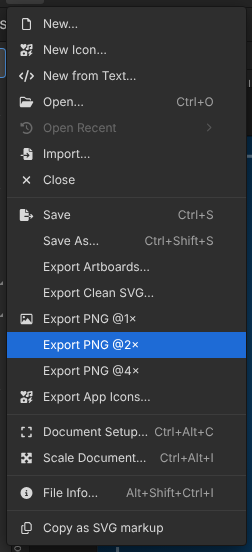

Get your drawing out as a file or onto the clipboard, for use elsewhere.

- The **Export** button (top right) → downloads the drawing as SVG.
- **File → Export PNG @1×**, **@2×** or **@4×** → downloads a PNG with a
  transparent background.
- **File → Copy as SVG markup** → puts the drawing (or the selection) on
  the clipboard as SVG markup.
- **File → Export Clean SVG…** → plain SVG for the web: see
  [Export Clean SVG…](#export-clean-svg).

### Export Clean SVG…

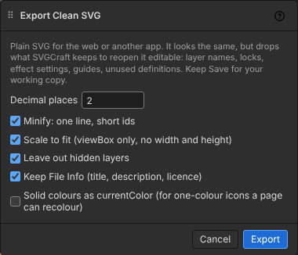

Save plain SVG for the web or another app, without SVGCraft's editing data.

1. Choose **File → Export Clean SVG…**.
2. Set the options (they're remembered).
3. Click **Export**. It saves `<name>.min.svg`.

Keep Save for your working copy: a clean SVG reopens as plain shapes.

#### Options

- **Decimal places** for coordinates (2 by default). Path data is compacted
  too.
- **Minify** (on by default): one line, with short ids.
- **Scale to fit** (on by default): only a viewBox, no width and height.
- **Leave out hidden layers** (on by default).
- **Keep File Info** (on by default): the title, description and licence.
- **Solid colours as currentColor**: for one-colour icons a page can
  recolour with CSS.

#### Good to know

- It draws exactly the same: effects, clips, masks, gradients and patterns
  stay as the real SVG that draws them.
- It leaves out what SVGCraft keeps to reopen the file editable: every
  `data-*` attribute (layer names, locks, effect settings, guides…),
  unreferenced ids, unused defs, comments, empty and attribute-free groups,
  and attributes set to their defaults.

### Shape tools

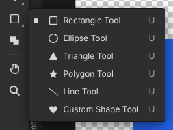

Draw rectangles, ellipses, triangles, polygons, stars, lines and arrows,
or any shape from the Symbols library.

1. Pick a Shape tool (U). The toolbar shows one Shape button, the last
   tool used: hold it, right-click it or Alt-click it for the flyout.
2. Set its options in the options bar: **Radius** for a rectangle,
   **Sides** and **Star ratio** for a polygon, **Arrowheads** for a line,
   **Shape** for a custom shape.
3. Drag a box on the canvas. Shift makes the sides equal (a line snaps to
   45°), and Alt draws from the centre.

#### The tools

- **Rectangle** (R): see [Rounded rectangles](#rounded-rectangles) for
  its corners.
- **Ellipse** (O).
- **Triangle**.
- **Polygon**: **Sides**, and a **Star ratio** below 100% pulls every
  other point in to make a star.
- **Line** (L): **Arrowheads** at the **Start**, the **End** or both.
- **Custom Shape**: any shape from the Symbols library, drawn into the box
  you drag with its proportions kept.

#### Draw at an exact size

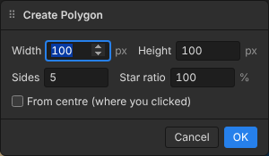

Click without dragging (with any Shape tool but Line) for Photoshop's
**Create** box:

- **Width** and **Height**, in the document's units.
- **Corner radius** (rectangles), or **Sides** and **Star ratio**
  (polygons).
- **From centre (where you clicked)**: off, the click is the top-left
  corner.

#### Good to know

- Shift+U steps through the group. R, O and L still pick the rectangle,
  ellipse and line.
- A polygon or star stays live: Properties changes its sides and star
  ratio later, until you edit its points by hand.
- Properties turns arrowheads on or off for any selected line or open
  path.
- Arrowheads are one shared SVG marker drawn in each line's own stroke
  colour (`context-stroke`), sized by its stroke width.

### Pencil

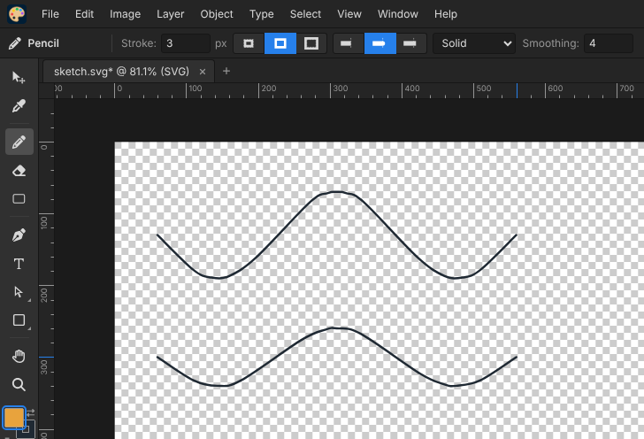

Draw freehand lines, smoothed as you go.

1. Pick the **Pencil**.
2. Set **Smoothing** in the options bar (0 to 10; 4 to start with). Higher
   gives smoother, simpler curves.
3. Drag on the canvas to draw.

#### Good to know

- The stroke settings in the options bar ([Stroke options](#stroke-options))
  apply to what you draw.
- How it works: the line you draw is simplified (RDP) and then fitted with
  curves (Catmull-Rom → Bézier).

### Pen

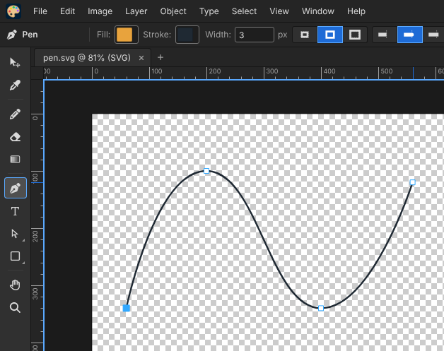

Draw precise paths, point by point, with straight lines and smooth curves.

1. Pick the **Pen**.
2. Click for a corner point, or drag for a smooth point with curve
   handles.
3. Carry on clicking or dragging. Shift snaps to 45°, and Backspace
   removes the last point.
4. Finish: click the first point to close the shape, or press Enter or
   double-click to leave it open. Esc also ends it.

#### Good to know

- To change the path afterwards, use [Edit points](#edit-points).

### Free Transform and Edit → Transform

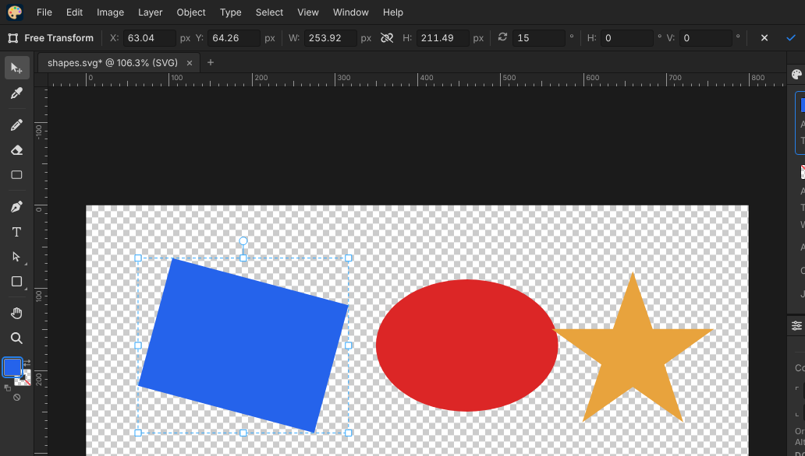

Scale, rotate and skew the selection by hand or by exact numbers, as in
Photoshop.

1. Select what to change and choose **Edit → Free Transform** (Alt+T).
2. Drag a corner to scale, or the top knob to rotate. Or type exact
   **X**, **Y**, **W** and **H** (with the proportion lock), an angle, and
   horizontal (**H**) or vertical (**V**) skew in the options bar.
3. Press Enter or click ✓ to commit. Esc or ✕ cancels the whole session.

#### Edit → Transform

- **Scale**, **Rotate** and **Skew** open the same session with the
  handles set to that job: corners and edges only scale, any handle
  rotates, or edge handles slide along their edge to skew. Shift snaps
  angles to 15°.
- **Rotate 180°**, **Rotate 90° Clockwise**, **Rotate 90° Counter
  Clockwise**, **Flip Horizontal** and **Flip Vertical** each apply in one
  step, about the selection's centre.
- **Again** (Alt+Shift+T) repeats the last transform about the selection's
  current centre.
- **Again with Copy** (Ctrl+Alt+Shift+T) duplicates first, so a 30°
  rotation repeated 11 times makes a ring of 12.

#### Good to know

- Browsers keep Ctrl+T and Ctrl+Shift+T for their tabs, so these shortcuts
  use Alt.
- Distort, Perspective and Warp aren't included: SVG transforms can only
  make straight-line (affine) changes.

### Align and distribute

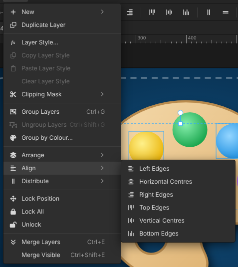

Line objects up with each other, or space them out evenly.

1. Select the objects with the Move tool.
2. Click an align or distribute button on the Move tool's options bar, or
   choose **Layer → Align** or **Layer → Distribute**.

#### Options

- **Align**: **Left Edges**, **Horizontal Centres** or **Right Edges**;
  **Top Edges**, **Vertical Centres** or **Bottom Edges**. Objects align to
  the selection's bounds.
- **Distribute** (horizontally or vertically): spaces three or more
  objects with equal gaps, leaving the outermost two where they are.

#### Good to know

- With one object selected, it aligns to the artboard instead, as in
  Photoshop.

### Eyedropper

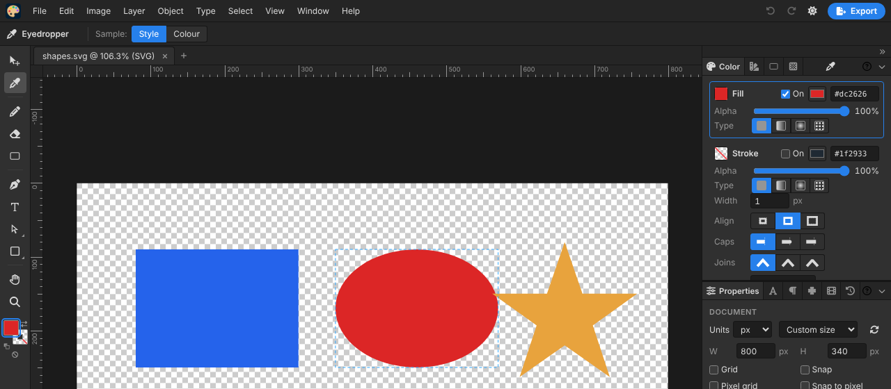

Copy a style or a colour from something already in the drawing.

1. Pick the **Eyedropper** (I).
2. Choose what it samples in the options bar: **Style** or **Colour**.
3. Click the shape or the colour you want.

#### Options

- **Style**: copies a shape's fill, stroke, alpha, stroke width and
  opacity into the current settings, and applies them to anything
  selected.
- **Colour**: takes the exact pixel you click, including blended
  transparency and placed images, into the active paint. A ring around
  the cursor previews the colour.

#### Tips

- Alt-click sends the colour to the other paint (fill or stroke).
- In Chromium browsers, the eyedropper button on the Color panel picks a
  colour from anywhere on the screen.

### Edit points

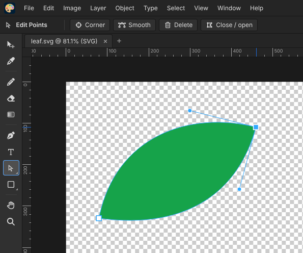

Reshape a path, or a basic shape, by moving its points and curve handles.

1. Pick **Edit Points** (A), or double-click a shape with the Move tool.
2. Click the shape, then drag its points and Bézier handles. The arrow
   keys nudge picked points.
3. Press Esc, or pick another tool, when you're done.

#### Picking points

- Shift-click points to pick several, or drag round them.
- Choose what a drag picks with from the Edit Points button's flyout (as
  with the Shape tools), or step through them with Shift+A: **Rectangle
  Select**, **Ellipse Select** (an oval) or **Lasso Select** (freeform).
- As in Photoshop, a drag begun with Shift adds to what's picked, and one
  begun with Alt takes points away. Alt pressed during a drag grows a
  rectangle or oval from its centre.

#### Changing points

- Double-click a segment to add a point.
- Double-click a point to switch it between corner and smooth (or use
  **Corner** and **Smooth** in the options bar).
- **Delete** (Del) removes the picked points.
- **Close / open** adds or removes the closing segment.
- Smooth points keep their handles in line. Alt-drag a handle to break
  one.

#### Good to know

- Works on paths with any command (arcs included) and on rectangles,
  ellipses, circles, lines, polylines and polygons.
- A basic shape turns into a `<path>` only once you change it.

### Fill rule and path direction

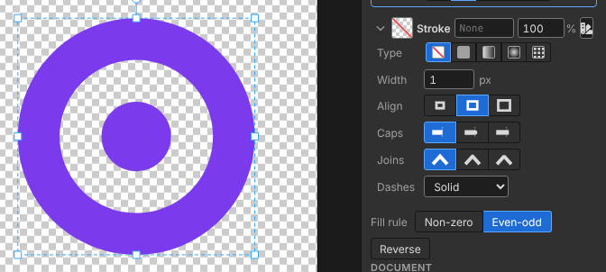

Decide which parts of a path that crosses itself, or holds other loops,
are filled and which are holes.

1. Select a path, polygon or polyline.
2. In **Properties**, set **Fill rule** to **Non-zero** or **Even-odd**,
   or click **Reverse** to run the outline the other way.

The same commands are in **Object → Path**: **Non-Zero Fill Rule**,
**Even-Odd Fill Rule** and **Reverse Direction**.

#### Options

- **Non-zero** (SVG's default): fills an area unless the outline's
  directions around it cancel out.
- **Even-odd**: makes every nested loop a hole, whichever way it runs.
- **Reverse** (Reverse Path Direction): runs the selected paths, polygons,
  polylines and lines the other way. Under non-zero, a loop running
  against its outer shape is a hole.

#### Good to know

- The fill rule is set on each selected shape, inside groups too, and
  saved as `fill-rule` (nothing for non-zero, unless a group or style
  above would make it even-odd).
- Reversing also flips where text on the path starts and which way dashes
  and markers run. A closed path keeps its starting point.
- Reversing turns rectangles, circles and ellipses into paths (a live
  rectangle's corners stop being editable as corners).

### Animate

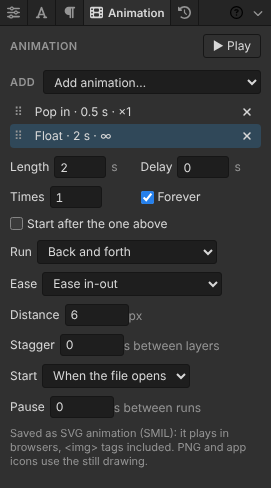

Make a layer or group fade, slide, spin, pulse, draw itself on and more,
in the saved SVG.

1. Select one layer or group and open the **Animation** tab.
2. Choose a preset from **Add animation…**.
3. Click its row and set its options below the list.
4. Click ▶ **Play** (or **View → Play Animations**) to preview the whole
   drawing. Esc, a click on the canvas or any edit stops it.

#### Presets

- **Entrances**: Fade in, Slide in, Pop in, Zoom in.
- **Exits**: Fade out, Slide out, Zoom out.
- **Loops**: Spin, Pulse, Bounce, Shake, Float, Blink.
- **Line effects**: Draw on, Draw off, Dash march.
- **Colour cycle**.

#### Settings

- **Length** and **Delay**, in seconds.
- **Times**, or **Forever**.
- **Start after the one above**: chains it to the end of the previous one
  (after its first run, if that one loops forever), with its delay counted
  from there. An entrance, a loop and an exit can then follow one another
  without adding up delays.
- **Run**: **Normal**, **Reverse** or **Back and forth**.
- **Ease**: Linear, Ease, Ease in, Ease out or Ease in-out.
- Each preset's own options, such as the slide side and distance, turns,
  how far to grow, or the colour to cycle to.

#### Several on one layer

- A layer can have several animations. They play together, each after
  its own delay.
- Drag a row's ⠿ grip, or press Alt+↑ / Alt+↓, to reorder them. When two
  move or scale the layer, they combine in list order.

#### In the file

- Animations are kept as settings on the layer (`data-sc-anim`) and
  written out as SVG animation (SMIL: `<animate>`, `<animateTransform>`,
  `<set>`) only when the drawing is saved. Editing and undo always see the
  shapes at rest.
- Moves, spins and scales are additive, so they happen about the layer's
  own centre, on top of its transform.
- SMIL plays in every current browser, including SVG shown in an ``
  tag. Each animation adds about 150–300 bytes.
- Export Clean SVG keeps the animation and rounds its coordinates like the
  rest. PNG, app icon and favicon exports use the still drawing.
- Reopening a saved file rebuilds the animations from their settings.

### Zoom and pan

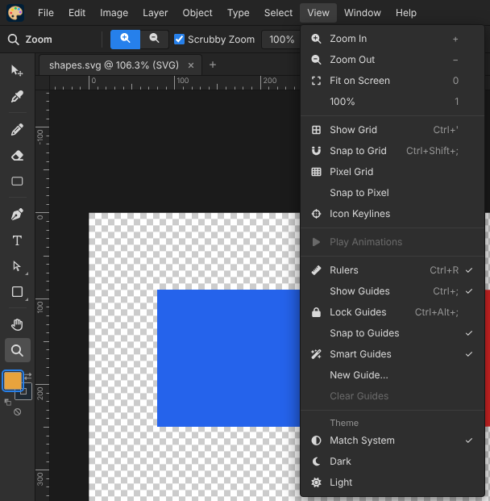

Get close to the detail, or step back to see the whole drawing.

- **Zoom tool** (Z): click to zoom in one step (50%, 66.7%, 100%, 200%,
  300% …). Alt-click, or choose the options bar's Zoom Out button, to step
  out.
- **Drag with the Zoom tool**: with **Scrubby Zoom** on, drag right to
  zoom in and left to zoom out, centred where you pressed. With it off,
  drag a box to fill the window with that area.
- **100%**, **Fit Screen** and **Fill Screen** are on the Zoom and Hand
  tools' options bar. Double-click the Zoom tool for 100%.
- **View menu**: **Zoom In** (+), **Zoom Out** (−), **Fit on Screen** (0)
  and **100%** (1).
- **Ctrl/⌘ + wheel**, or a pinch, zooms the canvas.
- **Pan**: scroll the wheel (Shift+wheel goes sideways), drag with the
  **Hand** tool, or hold Space and drag with any tool.

#### The page itself doesn't zoom

- The browser's zoom keys (Ctrl/⌘ + =, − and 0) zoom the canvas instead,
  like Photoshop's.
- Ctrl/⌘ + wheel or a pinch only ever zooms the canvas, never the panels.
- On phones and tablets the page can't be pinched or double-tapped
  bigger.

### Pixel grid and Snap to Pixel

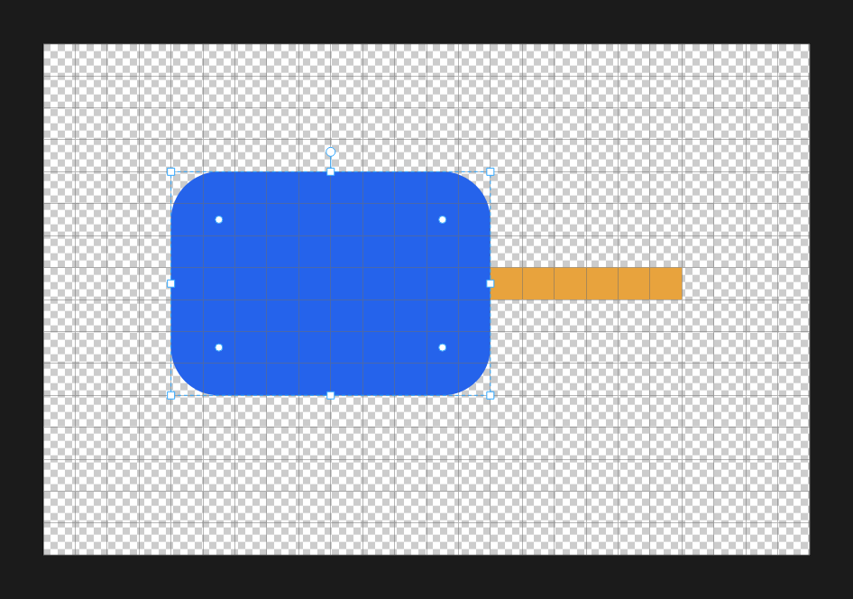

Keep icons and pixel art crisp, with edges on whole pixels.

1. Turn on **View → Pixel Grid** and **View → Snap to Pixel** (or the
   **Pixel grid** and **Snap to pixel** boxes under Document in
   Properties).
2. Zoom to 600% or more to see the grid.
3. Draw and move as usual: points and moved shapes land on whole pixels.

#### Good to know

- The pixel grid is a 1 px grid over the artboard, shown from 600% zoom
  up.
- Snapping to pixels keeps edges sharp in PNG exports and at small sizes.
- A centred stroke of odd whole width (1, 3 px …) snaps to half pixels
  instead, so its edges land on whole pixels.
- Guides and smart guides still win when they're close, and Snap to Grid
  wins when it's on.
- Both settings are remembered.

### Eraser

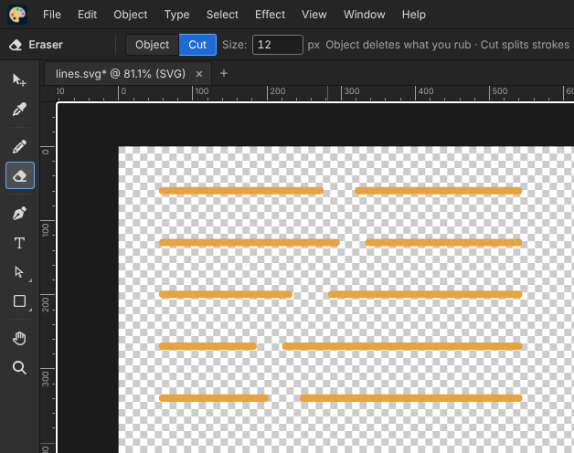

Rub out whole objects, or cut gaps in lines.

1. Pick the **Eraser**.
2. Choose **Object** or **Cut** in the options bar, and set its **Size**.
3. Rub over what you want to erase.

#### Options

- **Object**: deletes anything you rub.
- **Cut**: splits stroked lines and paths where you rub, and leaves filled
  shapes alone.

### Gradients

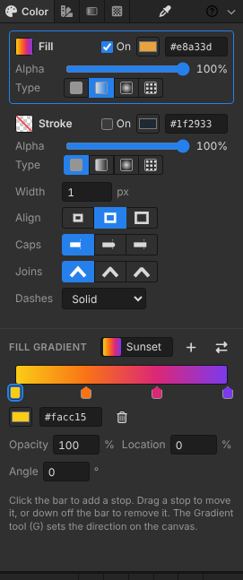

Fill or stroke a shape with a smooth blend of colours.

1. Select a shape and, in the **Color** panel, click **Fill** or
   **Stroke** to make it the active paint.
2. Set its **Type** to Linear or Radial (or back to Solid).
3. Edit the stops in the gradient editor below.
4. To set the direction on the canvas, pick the **Gradient** tool (G) and
   drag across the selection. Shift snaps to 45°, and a radial gradient
   drags from the centre outwards. Drag the end handles to adjust it.

#### The gradient editor

- **The bar**: click it to add a stop, drag a stop to move it, or drag it
  down off the bar to remove it.
- **Each stop** has a colour, **Opacity** and **Location**. The bin button
  deletes it.
- **Angle**: the direction, in degrees.
- **Reverse** (⇄) flips the stops.
- **Presets**: Colour → Transparent, plus everything in the Gradients
  panel.
- **+** saves the gradient to the Gradients panel.

#### Tips

- With a gradient active, clicking a swatch recolours the selected stop.
- The Gradient tool's options bar switches between **Linear** and
  **Radial** for the active paint of the selection.

#### Good to know

- Each shape gets its own gradient in its own coordinates, so angles stay
  true and the gradient moves, rotates and scales with the shape.
- Duplicates split off their own copy when edited, and unused gradients
  are removed automatically.
- Gradients in imported files are read, including ones that borrow stops
  from another gradient.

### Stroke options

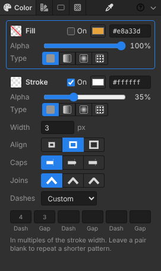

Set how outlines look: thickness, position, ends, corners and dashes.

1. Select a shape, or pick a drawing tool to set the stroke for what you
   draw next.
2. Set the stroke under **Stroke** in the **Color** panel, or in the
   drawing tool's options bar. Both show whatever other panel is open.

#### Settings

- **Width**: the thickness, in px.
- **Align**: **Inside**, **Center** or **Outside**, as in Photoshop, for
  closed shapes (rectangles, ellipses, polygons and closed paths).
- **Caps**: butt, round or square line ends.
- **Joins**: miter, round or bevel corners (in the Color panel).
- **Dashes**: **Solid**, **Dashed**, **Dotted** or **Long dash**.
- **Custom** dashes: opens Photoshop's dash / gap fields in the Color
  panel: up to three dash-and-gap pairs, in stroke widths. Imported dash
  patterns show up there too.

#### Good to know

- Dash lengths are in multiples of the stroke width, as in Photoshop, so
  they keep their proportions when the width changes.
- Dashes allow for round and square caps, which extend each dash, so
  dotted lines come out as round dots.
- SVG strokes are always centred, so an aligned stroke is drawn twice as
  wide and the unwanted half is hidden: clipped to the shape for Inside,
  and painted under the fill for Outside (masked when there's no fill).
  The width you set stays the visible width.
- Under a semi-transparent fill, the hidden half of an Outside stroke
  shows through faintly.
- Opening a path puts its stroke back to Center.

### Rounded rectangles

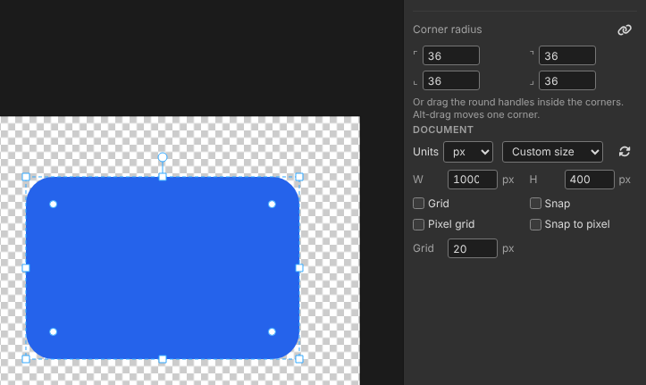

Round the corners of a rectangle, all together or one at a time.

- **Before drawing**: set a **Radius** on the Rectangle tool's options
  bar.
- **On a selected rectangle**: edit its four corners under **Corner
  radius** in Properties. The link toggle changes them all together.
- **On the canvas**: drag the round handles inside the corners. Alt-drag
  moves a single corner, as in Photoshop's live corners.

#### In the file

- Equal corners stay a plain `<rect rx>`.
- Unequal corners become a path that remembers it's a rectangle, so its
  radii stay editable until you edit its points.

### Patterns

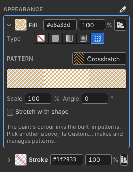

Fill or stroke a shape with a repeating tile: stripes, dots, bricks, or a
tile you make.

1. Select a shape and make fill or stroke the active paint.
2. Click a tile in the **Patterns** panel, or set the paint's **Type** to
   Pattern in the Color panel.
3. Adjust it in the pattern editor: **Scale**, **Angle**, or another
   pattern from its list.

#### Make your own

- Select what the tile should hold and choose **Edit → Define Pattern…**,
  as in Photoshop. The tile is the size of the selection's visible box.
- It looks the same as it does on the canvas, including transforms,
  gradients and clip paths.

#### Good to know

- The built-ins (stripes, diagonal, dots, grid, checks, crosshatch, waves,
  bricks, triangles) are drawn in the paint's colour, so changing the
  colour re-inks them.
- The tiles start at the shape's top-left corner.
- As with gradients, each shape gets its own `<pattern>` in its own
  coordinates, so the pattern moves and rotates with the shape.
- Patterns export as plain SVG.

### Libraries

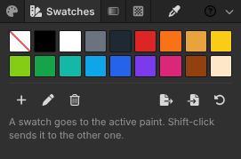

Keep your own colours, gradients and patterns to hand, and share them
with other apps.

- **Apply**: click a tile to apply it to the active paint, or Shift-click
  it to apply it to the other one.
- **Add** (**+**): adds the current colour (with its alpha), saves the
  active gradient, or defines a pattern from the selection. Each asks for
  a name.
- **Rename**: double-click a tile, or use the pencil button.
- **Delete**: Alt-click a tile, or use the bin button.
- **Reset** (↺): brings back the built-in set for that panel.

The **Swatches**, **Gradients** and **Patterns** panels all work this
way. They're saved in this browser (localStorage), like Photoshop's
presets.

#### Export

**Export**, on any of the panels, saves the whole library, symbols
included, as one `svgcraft-library.zip`:

- `svgcraft-library.json`: everything, for SVGCraft.
- `swatches.gpl`: a palette for GIMP, Inkscape and Krita.
- `swatches.css` and `gradients.css`: CSS custom properties
  (`--name: #hex`, `--name: linear-gradient(…)`).
- `gradients.svg` and `patterns.svg`: `<linearGradient>`,
  `<radialGradient>` and `<pattern>` defs for Inkscape, Illustrator and
  browsers, each drawn as a labelled sample. Pattern tiles draw in
  `currentColor`, set on each `<pattern>`.
- `symbols.svg`: an SVG sprite, one `<symbol id="…">` per symbol with its
  credit, for `<use href="symbols.svg#id"/>`.
- `README.txt`: what each file is.

Kinds with nothing in them are left out.

#### Import

**Import** adds a file's contents, skipping anything you already have
(the same colour, gradient, tile or symbol, whatever its name). If
something new has the name of one of yours, SVGCraft asks once for the
whole import:

- **Keep both** (the default): the imported one becomes "Sky 2".
- **Replace mine**: yours keeps its name and place and takes the new
  definition.
- **Skip them**.

It reads:

- the exported zip (from its `svgcraft-library.json`);
- a zip of palettes, gradients and SVGs without one (deflated or not, in
  folders or not);
- a JSON library;
- a GIMP palette (including GIMP 3's alpha) or a GIMP gradient (`.ggr`);
- any SVG, taking its gradients (shared stops included), patterns and
  symbols. Symbols from an SVG go in a category named after the file.

#### Good to know

- Browser storage belongs to one browser on one machine and is lost if
  you clear the site's data, so export to keep a copy.
- Pattern tiles and symbols from a file are sanitised like imported
  drawings.

### Colours

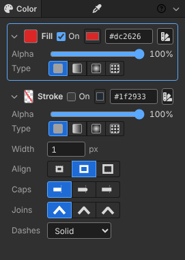

Set the fill and stroke colours of what you draw or have selected, and
how see-through they are.

1. Click **Fill** or **Stroke** in the **Color** panel (or the fill and
   stroke chips at the bottom of the toolbar) to make it the active
   paint.
2. Tick **On** to paint it, or untick it for none.
3. Pick a colour with the colour picker, type a hex code, or click a
   swatch in the Swatches panel.

#### Transparency

- **Alpha**, under Fill and under Stroke: how see-through each paint is.
- **Opacity**, in the Layers panel: how see-through the whole object is.
- The three are separate, and the artboard's checkerboard shows the
  result.

#### Shortcuts

- X (or **Edit → Swap Fill and Stroke**) swaps fill and stroke.
- Shift-click a swatch to apply it to the other paint.

### Selecting, moving and arranging

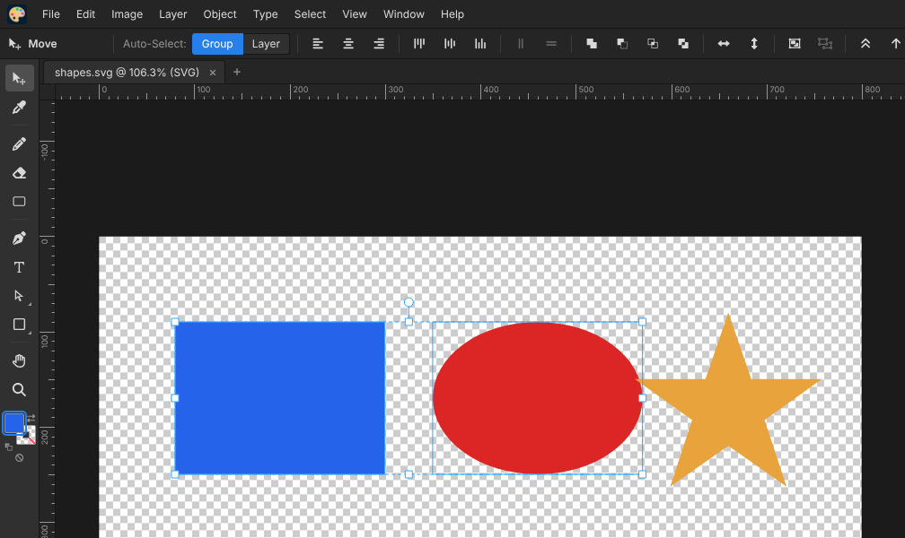

Pick objects, then move, resize, rotate, group and stack them.

- **Select**: click with the Move tool. Shift-click adds, and dragging on
  empty canvas draws a marquee. **Select → All** (Ctrl+A), **Deselect**
  (Ctrl+D) and **Inverse** (Shift+F7).
- **Move**: drag the selection, or nudge it with the arrow keys (Shift
  moves 10 times as far).
- **Resize and rotate**: drag the handles. Shift keeps the ratio, and Alt
  scales from the centre. Drag the knob above to rotate.
- **Flip**: the flip buttons on the options bar, or **Object → Flip
  Horizontal** / **Flip Vertical**.
- **Group** (Ctrl+G) and **Ungroup** (Ctrl+Shift+G).
- **Stacking order**: **Layer → Arrange**: Bring to Front (Ctrl+Shift+]),
  Bring Forward (Ctrl+]), Send Backward (Ctrl+[) and Send to Back
  (Ctrl+Shift+[).
- **Duplicate**: **Layer → Duplicate Layer**.
- **Undo and redo**: Ctrl+Z and Ctrl+Shift+Z.

#### More on this

- Selecting in the Layers panel: [Select layers](#select-layers) and the
  [Select menu](#select-menu).
- [Group and ungroup](#group-and-ungroup), and
  [Reorder, copy and delete](#reorder-copy-and-delete) in the Layers
  panel.
- [Show, hide and lock](#show-hide-and-lock) layers.
- The grid and snapping:
  [Rulers, guides and smart guides](#rulers-guides-and-smart-guides).
- Document size: [Units and page size](#units-and-page-size).
- [Zoom and pan](#zoom-and-pan).

## Type

Set headlines, labels and blocks of text with the Type tool (T), which works
like Photoshop's. Text stays live and editable, and saves as ordinary SVG
text.

### Add text

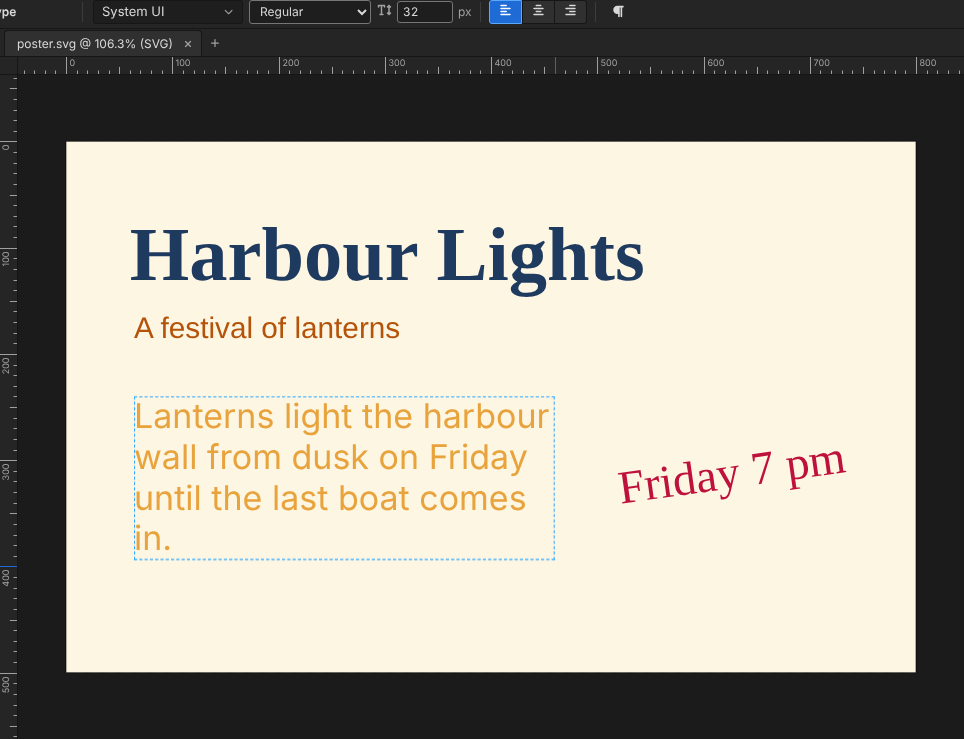

Type a single line, or a block that wraps inside a box.

1. Pick the **Type** tool (T).
2. Click where the text should start for **point text**, which grows as
   you type. Or drag a box for **paragraph text**, which wraps inside the
   box.
3. Type. Enter starts a new line.
4. Press Ctrl/⌘+Enter, or click away, to finish. Esc cancels.

#### The options bar

- **Font family**: opens the [font picker](#choose-a-font).
- **Style**: the weights and italics the font has.
- **Size**, in px. Drag the icon to adjust it.
- **Alignment**: left, centre or right.
- **Character and Paragraph panels** (¶): opens the
  [Character](#character-panel) and [Paragraph](#paragraph-panel) panels.

### Edit text on the canvas


Change the words of a text layer right where it sits.

- Click the text with the Type tool, or double-click it with Move → it
  opens for editing on the canvas.
- It's shown in its own font, size, colour and rotation while you type.
- Ctrl/⌘+Enter or clicking away finishes; Esc cancels.

#### Good to know

- Undo while typing covers the typing itself. Character-style changes are
  undone as part of the finished edit.

### Choose a font


Find a font and apply it, from your system fonts or the whole Google Fonts
catalogue.

1. Select a text layer (or the characters you're editing).
2. Click the font name in the options bar or the Character panel.
3. Type to search, or pick a category, then click a font.

#### The picker

- **Search fonts**: looks through every family. Names that start with what
  you typed come first, then names with a word that does, then names that
  contain it.
- **Popular** (where it opens): web-safe system fonts and about 40 popular
  Google Fonts.
- **All**: system fonts, the whole Google Fonts catalogue (about 1,900
  families) and any installed fonts.
- **Sans**, **Serif**, **Display**, **Script**, **Mono**: one Google Fonts
  category.
- **Show fonts installed on this computer…** (Chromium browsers): adds your
  own fonts through the browser's Local Font Access permission.

#### Good to know

- Each name is shown in its own face. It loads a tiny preview of itself as
  it scrolls into view.
- Long lists show their first 150 names and narrow as you type.
- The **Style** menu only offers the weights and italics the font really
  has.
- A drawing opened from elsewhere in any Google family loads that family.
- The catalogue (`google-fonts.js`, 13 KB compressed) is regenerated with
  `scripts/gen-google-fonts.mjs`.

### Style individual characters


Give some characters their own font, size or colour, as in Photoshop.

1. Edit the text (click it with the Type tool).
2. Select characters: drag, double-click a word, or Shift+arrows.
3. Change the font, style, size, tracking, baseline shift, caps,
   super/subscript, underline, strikethrough or **Fill** colour. Only those
   characters change.

#### Good to know

- The options bar, Character panel, font picker and colour controls all
  keep the edit open. They show the settings of the characters under the
  caret.
- With nothing selected while editing, a change applies to the whole layer.
- Applying a setting to a selected layer when you're not editing styles the
  whole layer and clears that setting from its characters, as in Photoshop.
- Auto leading is 120% of the largest size on each line. Paragraph text
  wraps by the real width of every run.

### Character panel


Set the font and spacing of a text layer, or of the characters you've
selected.

- Open it from **Type → Character Panel**, the Character tab, or the ¶
  button in the Type options bar.
- Select a text layer → changes apply to the whole layer. While editing →
  they apply to the selected characters.

#### Settings

- **Font family** and **Style**: as in the options bar.
- **Size**, in px.
- **Lead** (leading, line spacing): leave it empty for Auto, 120% of the
  size.
- **Track** (tracking): in thousandths of an em, as in Photoshop.
- **Shift** (baseline shift), in px.
- Toggles: **All Caps**, **Small Caps**, **Superscript**, **Subscript**,
  **Underline** and **Strikethrough**.
- Colour comes from the **Fill** paint.

### Paragraph panel


Set how lines line up and how wide a text box is, or switch between point
and paragraph text.

- Open it from **Type → Paragraph Panel** or the Paragraph tab.
- Select a text layer, then change its settings.

#### Settings

- **Alignment**: left, centre or right.
- **Box width**: the width of a paragraph text box, in px.
- **Convert to Paragraph Text** / **Convert to Point Text**: switches the
  kind of text. Also on **Type → Convert Point / Paragraph Text**.

### Text in the saved file


Your text and its fonts go with the file, so it looks the same elsewhere.

- Export an SVG → it links the Google Fonts it uses, so it renders the same
  in any browser.
- Export a PNG → the fonts are downloaded and embedded in the image, because
  an SVG drawn into an image isn't allowed to fetch fonts.
- Installed (local) fonts only look right on computers that have them.
- Need shapes instead of text? **Type → Create Outlines** (Ctrl+Shift+O)
  turns text into shapes (see [Create Outlines](#create-outlines)).

#### Good to know

- No Warp Text yet.
- A text layer is ordinary SVG text: one `<tspan>` per line and a nested
  `<tspan>` per styled run, with the settings in standard attributes. The
  type details survive export and import, and other editors can read the
  file.

## Text on a path

Set text along a curve, a circle or any shape's outline, like Illustrator's
Type on a Path. The text stays live: edit the path and the text follows.

### Put text on a path


Run a line of text along a path or round a shape.

1. Select one text layer and one path or shape (a path, rectangle, ellipse,
   circle, polygon, polyline or line): Shift-click both.
2. Choose **Type → Text on Path**, or click **Put Text on Path** in the
   Properties panel.

#### Good to know

- The text's lines are joined into one, with a space where each line break
  was.
- Its fonts, per-character styles, fill, effects, blend mode, lock and name
  stay.
- The path layer stays where it is and keeps its own paint. Give it no
  stroke, or hide it, if you only want the text.
- On a closed shape the text starts where the shape does: an ellipse's or
  circle's right-hand point, a rectangle's top-left corner.

### Adjust text on a path


Slide the text along its path, flip it, reshape the path or change the
words.

- Select the text-on-path layer → the Properties panel shows its options.
- Move, rotate, scale or point-edit the path layer, or the group it's in →
  the text re-flows along it straight away.
- Move the text layer on its own → it stays on the path, because the text
  follows the path.
- Double-click the text with Move, or click it with the Type tool → edit
  the words. It's edited as one straight line where it starts on the path;
  Enter or clicking away finishes.

#### Options

- **Start**: where the text starts along the path, in percent.
- **Align**: the text starts at, is centred on, or ends at that point.
  Picking one also sets Start to 0, 50 or 100%.
- **Flip**: puts the text on the other side of the path, running the other
  way.

#### Good to know

- Character panel and options-bar changes (font, size, tracking, colour,
  caps…) apply to the whole text and keep it on the path.
- Paragraph settings that need lines (box width, Convert to Paragraph Text)
  don't apply.

### Release text from a path


Turn text on a path back into ordinary text.

1. Select the text-on-path layer.
2. Choose **Type → Release Text on Path**, or click **Release Text on
   Path** in the Properties panel.

It becomes one line of point text, placed where it started on the path.

#### If the path layer is deleted

- The text keeps the last shape it ran along and stays where it was, so
  nothing jumps or disappears. The Properties panel says its path layer is
  gone.
- Release it to make it ordinary text again.

### How text on a path is saved


Text on a path is standard SVG, so other browsers and editors show it.

- The text is a standard `<text>` with a `<textPath>` pointing at a copy of
  the path's shape in `<defs>`. SVG ignores the referenced path's own
  transform, so the copy is kept in the text's coordinates.
- `data-sc-textpath` on the text names the path layer's id. The path layer
  gets an id if it had none.
- The link survives Save → reopen, Import and paste (ids that clash are
  renamed and the link follows), undo and Duplicate. Duplicating the text
  with its path links the copy to the copied path.

## Layers

The Layers panel works like Photoshop's. Every shape is a layer, groups are
folders, and you select, stack, hide, lock, blend and style layers from it.

### Layer rows and folders


Use the Layers panel to see what your drawing is made of and pick out any
part of it.

- **One row per layer.** Every shape is a layer, including the shapes
  inside a group.
- **Groups are folders.** Click a folder's arrow to expand or collapse it.
  Each level is indented.
- **Imported SVGs** arrive as a folder named after the file, with one layer
  per shape inside it.

#### Good to know

- Everything works at any depth. Move, scale, rotate, flip, nudge, align,
  distribute, duplicate, copy, colours, the eraser and point editing all
  work on a layer inside a group, so you never have to ungroup first.
- Every row has a preview, groups (of what's in them) and hidden layers too.
- Previews are drawn just after the list: the rows in view first, the rest
  while the browser is idle. So a long list appears at once.

### Select layers


Pick the layers you want to work on.

- **Click** a row to select it.
- **Ctrl/⌘-click** a row to add it to the selection, or remove it.
- **Shift-click** a row to select the run of rows from the last one you
  clicked.

A group and a layer inside it are never selected together.

### Group and ungroup


Put layers in a folder so they move, hide and style together.

1. Select the layers.
2. Press Ctrl+G, choose **Layer → Group Layers**, or click the folder button
   at the bottom of the panel.

The new group (Group 1, Group 2 …) goes where the frontmost of the layers
was. With nothing selected, you get an empty group.

To take a group apart again, select it and choose **Layer → Ungroup
Layers** (Ctrl+Shift+G).

### Reorder, copy and delete


Change what's in front, or copy and delete layers, by dragging their rows.

- **Reorder:** drag a row. Drop on the top half of a row to put the layer in
  front of it, or on the bottom half to put it behind.
- **Into a group:** drop on the middle of a folder.
- **To the back:** drop on the empty space at the bottom of the list.
- **Copy in place:** drop rows on the New button (the plus square) at the
  bottom of the panel, as in Photoshop. The copies go just above the
  originals.
- **Delete:** drop rows on the bin.

Dragging a selected row moves the whole selection.

#### Good to know

- Clicking New duplicates the selection, a little offset.
- Layers never move on screen when they change groups. Paint they inherited
  from their old group (such as an icon's `fill="none"`) goes with them.

### Show, hide and lock


Hide layers you're not working on, and lock the ones you don't want to
change by accident.

- **Hide or show:** click a row's eye.
- **Show just one layer:** Alt-click its eye, as in Photoshop. Every other
  layer hides (the groups it's in stay shown). Alt-click it again and the
  others come back as they were.
- **Lock:** select layers and click a **Lock** button at the top of the
  panel, or use **Layer → Lock Position / Lock All**.
- **Unlock:** click the padlock on the row, or choose **Layer → Unlock**.

#### Lock options

- **Lock position**: stops the layer moving, scaling, rotating, flipping,
  nudging and aligning.
- **Lock all**: stops every change: paint, styles, blend mode, point and
  text edits, deleting and erasing.

#### Good to know

- Locked layers can still be selected.
- A lock on a group covers everything in it.

### Rename a layer


Give layers names you'll recognise.

1. Double-click the layer's name.
2. Type the new name.
3. Press Enter to save, or Esc to cancel.

An empty name goes back to the automatic one.

#### Good to know

- Names are saved as `data-name`, which Illustrator uses too.
- Inkscape layer labels are read on import.

### Blend mode and opacity


Make a layer see-through, or mix it with the layers below.

1. Select the layer or group.
2. Pick a blend mode from the menu at the top of the panel.
3. Type an **Opacity**, or drag its label.

#### Blend modes

- **Normal**, **Darken**, **Multiply**, **Color Burn**, **Lighten**,
  **Screen**, **Color Dodge**, **Overlay**, **Soft Light**, **Hard Light**,
  **Difference**, **Exclusion**, **Hue**, **Saturation**, **Color** and
  **Luminosity**, as in Photoshop.
- **Pass Through** (groups only): the group's layers blend with whatever is
  below the group. A new group starts out on Pass Through.

#### Good to know

- Blend mode and opacity belong to a layer, and a group is a layer: on a
  group they apply to the group as a whole.
- Setting a group to Normal isolates it, so its layers blend only with each
  other. Any other mode isolates it too.
- They're saved as the layer's CSS (`mix-blend-mode`, `isolation`), which
  browsers apply to exported SVGs too.

### Merge layers


Turn several layers into one, as in Photoshop, but the result stays vector
and nothing on screen changes.

1. Select what to merge.
2. Choose **Layer → Merge Down** (Ctrl+E). The menu item names what it will
   do.

#### What gets merged

- **Merge Down**: one layer selected merges it into the one below, keeping
  the lower one's name.
- **Merge Layers**: several layers selected merge into one.
- **Merge Group**: a selected group's contents merge into one.
- **Merge Visible** (Ctrl+Shift+E): merges every visible layer and leaves
  hidden ones alone.

#### Good to know

- Shapes alike in every way that shows become one path. Side by side, their
  outlines are joined; overlapping, they're united, which looks the same
  only for opaque fills with no stroke.
- Anything else becomes one group.

### Group by Colour


Tidy a drawing, an imported one say, into one group per colour.

1. Choose **Layer → Group by Colour…**.
2. Read the warning and click **Group by Colour**. It asks first, because it
   takes every group in the drawing apart and reorders the layers.

Each group is named after its colour or its swatch. One undo puts
everything back.

#### Good to know

- Shapes with no fill are grouped by stroke. Gradients and patterns are
  grouped by which one they use.
- The drawing looks the same afterwards. A layer only joins its colour's
  group when nothing of another colour that overlaps it is stacked in
  between. Otherwise its colour gets a second group ("Red 2").
- Groups whose look depends on being a group stay whole and are grouped as
  one layer: a clipping mask, layer style, filter, blend mode, opacity below
  100% or an animation. So do locked groups. They're named "Mixed" if they
  hold more than one colour.

### Layer via Copy / Cut


Put the selected part of a layer on a new layer above it, as in Photoshop.

1. Select layers, or pick points with Edit Points.
2. Choose **Layer → New → Layer via Copy** (Ctrl+J) or **Layer via Cut**
   (Alt+Shift+J).

The new layer is selected with the Move tool.

#### With layers selected

- **Layer via Copy** copies them in place. (Duplicate Layer offsets its copy
  by 10 px so it shows.)
- **Layer via Cut** lifts shapes picked inside a group (Auto-Select: Layer)
  out onto layers of their own, just above the group and looking the same.

#### With points picked

- The segments between the points go to a new path, drawn like the
  original.
- **Layer via Copy** leaves the original whole.
- **Layer via Cut** takes them out, and the original splits where they were.

### Layer Style (fx)


Add shadows, glows, an overlay or a blur to a layer, as with Photoshop's
Layer Style dialog.

1. Select the layer.
2. Open the dialog: click the **fx** button at the bottom of the Layers
   panel, choose **Layer → Layer Style…**, or double-click the layer's fx
   badge. Double-clicking a row anywhere but its name (the thumbnail, or the
   space after the name) opens it too.
3. Tick an effect on the left to turn it on, or click its name to turn it on
   and edit it.
4. Watch the canvas preview the changes as you edit. Untick **Preview** to
   compare.
5. Click **OK** to keep them. **Cancel** or Esc puts everything back.

To remove all the effects, choose **Layer → Clear Layer Style**.

#### Effects

- **Drop Shadow** and **Inner Shadow**: colour, opacity, angle, distance,
  spread / choke and size.
- **Outer Glow** and **Inner Glow**: colour, opacity, spread / choke and
  size.
- **Color Overlay**: colour and opacity.
- **Gaussian Blur**: radius.
- **Blending Options**: blend mode and opacity.

#### Good to know

- Angles, distances and sizes are in document pixels, as in Photoshop, so a
  rotated or scaled layer still casts its shadow the same way.
- Each layer gets its own SVG `<filter>`, which follows the layer as it
  changes and is exported with it.

## Tooltips


Hover over any button to find out what it does.

- **Hover** a button for its tooltip. Tools also show a one-line
  description of what they do.
- **Tab** to a button to show its tip too.
- **Tap** a button on a touch screen to show its tip briefly.

Tooltips float above everything, panels and menus included, and fade after
three seconds.

## Combine Shapes

Merge shapes into one path, as Photoshop and Illustrator do.

### Combine selected shapes


Build a new shape out of simpler ones: a keyhole from a circle and a
rectangle, a crescent from two circles.

1. Select two or more shapes.
2. Click one of the four buttons in the Move tool's options bar, or choose
   **Object → Combine Shapes** and a mode.

The result takes the place, name and style of the topmost shape (the
backmost one for Subtract Front). It keeps its curves, so you can point-edit
it straight away.

#### Modes

- **Unite**: the outline of all the shapes together.
- **Subtract Front**: the backmost shape minus everything in front of it.
- **Intersect**: only the area where all the shapes overlap.
- **Exclude**: the areas where an odd number of shapes overlap, so the
  overlaps become holes.

#### Good to know

- A group counts as one shape made of everything in it.
- Rotated, scaled and nested layers combine where they are on screen.
- Text and images are skipped, and you get a message saying so.
- The geometry comes from [paper.js](http://paperjs.org), which loads the
  first time you combine shapes.

## Clipping masks

Show art only through the outline of a shape or text, as Illustrator does.
The clip stays live, so you can move the window or the art afterwards.

### Make a clipping mask


Show your art only through the outline of the topmost shape.

1. Put the shape or text that will be the window on top of the art.
2. Select it and the layers to clip.
3. Choose **Layer → Clipping Mask → Make** (Ctrl+Alt+G), or click the
   scissors button at the bottom of the Layers panel.

Everything selected goes into a new "Clipping group" where the clipping path
was, without moving on screen. Only the art inside the clipping path's
outline shows; the clipping path itself isn't painted.

#### Good to know

- The topmost selected layer is the clipping path. It has to be a single
  shape or a text layer. Anything else (a group, an image) gets a message
  saying why, and nothing changes.
- Locked layers can't be clipped.
- The clip is saved in the file and is still live when you open it again.

### Edit the clip


Change what shows through the window, without touching the art.

- **Move the window:** click the clipping path's row to select it, then
  move, transform or point-edit it. The window changes and the art stays
  put.
- **Move everything:** select the group and move it. Both move together.
- **Clip more art:** drop another layer into the group.
- **End the clip:** delete the clipping path, or drag it out of the group.

In the Layers panel the group and the clipping path are marked with
scissors, and the clipping path's name is underlined.

#### Good to know

- Duplicated clipping groups clip on their own.

### Release a clipping mask


Turn the clip off and get the clipping path back as an ordinary shape.

1. Select the clipping group, or any layer in it.
2. Choose **Layer → Clipping Mask → Release** (Ctrl+Alt+Shift+G).

The clipping path shows again with its own fill and stroke, and the layers
stay grouped, the group renamed as a plain group (Group 1 …).

#### Good to know

- A locked clipping group can't be released.

## Create Outlines

Turn text into shapes, as Illustrator's Create Outlines and Photoshop's
Convert to Shape do, so the drawing no longer needs its fonts.

### Turn text into outlines


Use it before sending a drawing to someone without your fonts, or to
reshape the letters with Edit Points.

1. Select the text layers, or groups with text inside.
2. Choose **Type → Create Outlines** (Ctrl+Shift+O).

Each text layer becomes filled paths that look exactly like the text did.
One undo brings the text back.

#### What carries over

- **Placed as drawn.** Every character goes where the browser drew it, so
  kerning, tracking, alignment, line spacing, paragraph wrapping, baseline
  shift, super/subscript and rotation all carry over. All Caps becomes
  capitals and Small Caps becomes smaller capitals.
- **One path per style.** Each layer becomes a group named "…
  (outlines)", holding one path per character style in that style's fill,
  stroke and opacity. So a bold word or a red word is its own path.
  Underline and strikethrough become bars in the same paths.
- **Keeps the layer.** The group takes the text's place in the stack, its
  transform, Layer Style effects, blend mode, opacity, lock and hidden
  state.

#### Limits

- Characters are outlined one by one, so ligatures and the joined forms of
  scripts like Arabic and Devanagari aren't reproduced.
- Small Caps uses scaled capitals rather than a font's own small caps.
- A gradient that fills text is measured against each path rather than the
  whole line.
- A bold the family doesn't have, which the browser fakes by thickening the
  letters, comes out at the family's nearest real weight.
- The glyph shapes come from [opentype.js](https://opentype.js.org), which
  loads the first time you create outlines.

### Fonts for outlines


Create Outlines draws each letter from the real font file, so it has to get
that file first.

- **Google Fonts** download from Fontsource's CDN (jsDelivr). Extra
  character sets (Latin Extended, Cyrillic, Greek, Vietnamese) are fetched
  only when the text needs them.
- **Fonts installed on your computer** are read directly once you've allowed
  installed fonts in the font picker (Chromium only).
- **System fonts** otherwise use open stand-ins, and the message says which.
- **A font the browser fakes** (an italic the family doesn't have) is
  slanted the same way.
- **If a font can't be downloaded** (offline, say), that layer is left as
  text and the message says why.

#### Stand-ins

- **Arimo** for Arial and Helvetica, **Tinos** for Times New Roman and
  **Cousine** for Courier New. These three match the originals letter for
  letter.
- **Gelasio** for Georgia, **DejaVu Sans** for Verdana, **Fira Sans** for
  Trebuchet MS, **Anton** for Impact and **Roboto** for System UI.

## Icons

Tools for drawing icons and app icons: a square artboard with margin guides,
keylines to size shapes against, a live preview at icon sizes, and an export
with every size each platform asks for. See also the pixel grid and Snap to
Pixel, under Features.

### File → New Icon…


Start an icon on a square artboard, with its margins already marked as guides.

1. Choose **File → New Icon…**.
2. Pick a **Template** for the platform you're drawing for, or leave it on
   **Custom** and type a **Size** and **Margin**.
3. Click **Create** (or press Enter). The icon opens in a new tab called
   `icon-<size>`, with guides shown.

#### Settings

- **Template**: sets the size and margins from the platform's guidelines,
  says what the guides mean, and sets the icon preview's mask (see
  Templates below). Changing the size yourself goes back to Custom.
- **Size**: type a size (8 to 2048 px), or pick a common one (16 to 2048)
  from the box's list.
- **Margin**: becomes a guide on all four sides. It follows the size (a
  twelfth of it) until you type your own.
- **Centre guides** (on by default): adds a guide across the middle each
  way.
- **Open the icon preview** (on by default): opens
  [Window → Icon Preview](#window-icon-preview) beside the canvas, masked
  the way the template's platform shows it.

#### Templates

- **Material system icon**: 24 px with 2 px padding.
- **Favicon**: 32 px, with a 1 px margin.
- **Android adaptive icon**: 108 dp at 4× (432 px), with guides around the
  72 dp area launchers show and the 66 dp safe zone inside it. Preview:
  circle mask, adaptive crop.
- **Google Play icon**: 512 px, full bleed. Preview: rounded mask.
- **iOS app icon**: 1024 px, full bleed (iOS rounds the corners itself).
  Preview: iOS mask.
- **macOS app icon**: 1024 px with guides around the 824 px body.

#### Good to know

- The margins are ordinary guides, so they move, lock, snap and save like
  any other guide.
- An untouched Untitled tab gives way to the icon.

### View → Icon Keylines


Size an icon's main shape so that round, square, tall and wide icons look
equally big side by side.

1. Choose **View → Icon Keylines**. Material's keyline shapes appear in the
   live area: a circle, a square, upright and wide rectangles, the diagonals
   and the centre lines.
2. Size your icon's main shape to the keyline that matches it: a round icon
   to the circle, a tall one to the upright rectangle, and so on.
3. Choose **View → Icon Keylines** again to hide them.

#### Good to know

- The live area is inside the guides nearest each edge, so moving a margin
  guide moves the keylines. Without guides, it's a twelfth in from each
  edge.
- Keylines aren't part of the drawing: they're never saved or exported.

### Window → Icon Preview


See your icon at the sizes people will see it, while you draw it.

1. Choose **Window → Icon Preview** (Ctrl+Alt+P). A pane docks beside the
   canvas (see Split view) with the drawing at 16, 24, 32, 48, 64 and
   128 px.
2. Keep drawing: the previews update as you work.
3. Click a size to show the canvas at that size.

#### Options

- **Background**: **Light**, **Dark** or **Transparent** (a
  checkerboard), or **All** three. It starts on the app's theme.
- **Mask**: how platforms crop app icons. **iOS** is a rounded square, as
  iOS and macOS draw app icons. **Circle** and **Squircle** are Android
  launchers' shapes. **Rounded** rounds the corners by a fifth, as Google
  Play and Android do. **None** shows the whole square.
- **Adaptive crop**: shows only the middle 72 dp of a 108 dp Android
  adaptive icon, the part launchers show (and mask).

#### Good to know

- The button in the title bar floats the pane, and docks it back. Esc
  closes it.
- Its options, whether it's docked, and how wide it is are remembered.
- The previews are drawn by the browser just as a web page would draw the
  SVG.

### File → Export App Icons…


Save every icon size each platform asks for, in one zip, ready to drop into
a website or an app project.

1. Draw the icon: square artwork works best (see
   [File → New Icon…](#file-new-icon)).
2. Choose **File → Export App Icons…**.
3. Tick the platforms you need and pick a **Background** colour.
4. Click **Export**. You get `<name>-app-icons.zip`, with a `README.txt`
   saying where each folder goes.

Each size is drawn from the vector art, not scaled from one big bitmap.

#### Platforms

- **Web**: `favicon.ico` (16, 32 and 48 px), `favicon.svg`,
  `apple-touch-icon.png` (180), `icon-192.png` and `icon-512.png`, a
  `site.webmanifest`, and `head.html`, the `<link>` tags to paste into your
  pages.
- **iOS**: `AppIcon.appiconset` (one 1024 px icon and its `Contents.json`)
  to drag into an Xcode asset catalogue.
- **Android**: a `res/` folder to copy into `app/src/main/`, and the
  512 px Play Store icon. See Android adaptive icons below.
- **macOS**: `AppIcon.icns`, and the `AppIcon.iconset` it's built from
  (16 to 1024 px), for `iconutil`.
- **Background**: the colour for icons that can't be transparent (see Good
  to know) and for Android's adaptive background when there's no
  Background layer.

#### Android adaptive icons

- The adaptive icon (Android 8+) has 108 dp foreground, background and
  monochrome layers for mdpi to xxxhdpi. `mipmap-anydpi-v26/ic_launcher.xml`
  and `ic_launcher_round.xml` tie them together.
- The monochrome layer is the foreground's shape, for Android 13's themed
  icons.
- Legacy square and round `ic_launcher` PNGs (48 to 192 px) are there for
  older launchers.
- A top-level layer named **Background** is never part of the foreground.
  On artwork drawn on New Icon's Android adaptive template, it becomes the
  background layer. Otherwise the background is the **Background** colour
  (`values/ic_launcher_background.xml`).
- Artwork drawn on the Android adaptive template (a 108 dp canvas,
  recognised by its guides 1/6 in) is used as drawn, edge to edge. The
  legacy and Play Store icons show its middle 72 dp, as a launcher does.
- Any other icon is fitted into the 66 dp safe zone, so no launcher mask
  cuts into it.

#### Good to know

- The iOS icon and the Apple touch icon can't be transparent. They're
  filled with the **Background** colour and saved without an alpha channel,
  as the App Store requires. So is Android's adaptive background when
  there's no Background layer.
- The rest keep their transparency.
- A non-square artboard is centred in each square icon.

## Symbols

A symbol is artwork you reuse: draw it once, place it as often as you like,
and change every copy at once by editing the symbol, as in Illustrator. The
**Symbols** panel sits next to Properties, Character and Paragraph.

### Make a symbol


Turn artwork you'll use again into a symbol.

1. Select the artwork.
2. Choose **Object → Make Symbol…** (or the plus button in the Symbols
   panel).
3. Type a name and click **Make**.

The selection is replaced by one instance of the symbol, exactly where it
was, so nothing moves on screen. Effects, gradients and patterns the artwork
uses go with it.

### Place a symbol


Add another copy (an instance) of a symbol to the drawing.

- Click a symbol in the Symbols panel, then the **Place** (clone) button →
  an instance in the middle of the view.
- Double-click a symbol → the same.
- Drag a symbol onto the canvas → an instance where you let go.

#### Managing symbols

- **Rename**: the pen button, or double-click the symbol's name. Instances
  still called after the symbol follow the new name.
- **Delete**: the bin button. If the symbol has instances, you're asked
  whether to **Break Links** (the instances stay, as ordinary groups) or
  **Delete Instances** too.

### Symbol instances


Use instances like any other layer, and break the link when one needs to
go its own way.

- Select, move, scale, rotate, flip, align, duplicate, lock and hide them,
  and set their opacity, blend mode and Layer Style.
- The Layers panel marks them with a clover and shows the symbol's name.
- To turn instances into ordinary groups that no longer follow the symbol,
  select them and choose **Object → Break Link to Symbol** (or the panel's
  broken-link button). They get their own copies of any gradients or
  effects inside.

#### Colour

A colour you give an instance goes onto the instance, so it only shows on
the parts of the symbol that don't have a colour of their own. To recolour
the artwork itself, edit the symbol.

### Edit a symbol


Change a symbol, and every instance of it, at once.

1. Double-click an instance (or select it and choose **Object → Edit
   Symbol**, or use the panel's nib button).
2. The rest of the drawing dims and steps back, and the symbol's artwork
   appears in place of that instance. Edit it with any tool: anything you
   draw goes into the symbol, and every other instance follows as you work.
3. Click **Done** in the bar at the top, press Esc, or double-click an
   empty spot to finish.

Each edit is a step in the drawing's undo history. Undoing while you edit
keeps you editing.

#### In the file

- Symbols are saved as real SVG `<symbol>` and `<use>` elements, so other
  viewers draw them too.
- They survive saving and reopening, and copy and paste (pasting instances
  of a symbol the drawing already has reuses it).
- Importing into another drawing brings them along: clashing ids are
  renamed and the instances follow.
- Symbols in an imported file, including the top-level `<symbol>`s of icon
  sprite sheets, show up in the panel.
- Define Pattern on an instance takes the symbol into the tile.

### The Symbols library


Keep symbols to use in any drawing, and use the built-in icons.

1. In the Symbols panel, switch from **This drawing** to **Library**.
2. Find a symbol with the category menu and the search box, which matches
   names and categories.
3. Place it with the **Place** (clone) button, by double-clicking it, or by
   dragging it onto the canvas.

Placing adds the symbol to the drawing's own symbols and puts an instance in
the middle of the view, or where you drop it. From then on it's an ordinary
symbol: edit it, break its link, rename it. If the drawing already has the
same artwork it's reused, so placing an icon ten times gives one symbol and
ten instances.

#### Save to the library

- Select a symbol in This drawing (or an instance of one), then click
  **Save to Library**: the book button under This drawing, or the plus
  button in the Library.
- It's copied into the library at the size it is, in the **Saved**
  category.

#### Managing the library

- **Rename**: double-click an entry's name, or the pen button.
- **Delete**: the bin button, or Alt-click the entry.
- **Reset**: puts the built-in icons back. It only touches the symbols.
- **Export** and **Import**: the library travels in the same library file
  as the swatches, gradients and patterns, and lives in this browser with
  them.

#### The built-in icons

- 80 icons from Font Awesome Free 6.7.2, in eleven categories: Arrows,
  Shapes, Interface, Communication, Weather, People, Objects, Nature,
  Charts, Faces and Places.
- They're placed 64 px tall, in the current fill colour.
- They don't set a colour of their own, so the instance's fill paints them:
  select an instance and pick a colour in the Color or Swatches panel to
  recolour it.
- Each icon's `<symbol>` carries its credit
  (`data-credit="Font Awesome Free 6.7.2 — CC BY 4.0"`), so the attribution
  stays in any drawing that uses it.

#### Good to know

- Library files are checked on the way in like any imported drawing:
  scripts, event handlers, `javascript:` links and style sheets are taken
  out of imported symbols.
- Entries that don't make sense are skipped.

## File Info

Give the drawing a title, an author, a description and a licence, saved in
the SVG file itself in the standard way (Inkscape calls this Document
Metadata).

### Describe the drawing


Say what the drawing is, who made it and how others may use it.

1. Choose **File → File Info…** (Alt+Shift+Ctrl+I, as in Photoshop).
2. Fill in the fields you want.
3. Click **OK**. It's one undo step and puts the \* on the tab. Cancel or
   Esc throws the edits away.

#### Fields

- **Title**, **Author** and **Description**: free text.
- **Keywords**: comma separated.
- **Date**: free text, today's date to start with. A date on its own,
  with every other field empty, isn't saved.
- **Copyright Status**: Unknown, Copyrighted or Public Domain.
- **Copyright Notice**: for example "© 2026 Your Name".
- **Licence**: None, CC BY, BY-SA, BY-ND, BY-NC or BY-NC-SA 4.0, CC0 1.0,
  All rights reserved, or a custom URL (**Licence URL**).
- **Source / Info URL**: where the drawing comes from, or more about it.
- **Language**: a language code such as `en` or `fr-CA`.

The source and a custom licence must be `http://` or `https://` addresses.
Anything else is refused with a note under the fields.

#### Good to know

- Each tab has its own File Info, and it comes back with the tab after a
  reload.
- A titled drawing's tab shows the title in its tooltip.
- Importing or pasting an SVG into a drawing leaves the drawing's own File
  Info alone.
- Copy and cut of a selection leave the File Info out, since it describes
  the whole drawing. Copy as SVG markup with nothing selected copies the
  whole file, File Info included.
- Open reads File Info back, including from Inkscape's files (older
  `http://` Creative Commons URLs are recognised and written back as
  `https://`). It falls back to a plain `<title>` / `<desc>`.
- Other RDF fields Inkscape can write (publisher, contributors, identifier,
  relation, coverage) aren't kept: a field the dialog doesn't show is
  dropped when the file is saved again.

#### In the file

- The title and description become the root's first `<title>` and `<desc>`.
  Screen readers read them, and browsers show the title as a tooltip.
- Everything goes into a `<metadata>` block of RDF/XML in the shape
  Inkscape writes: a `cc:Work` with Dublin Core `dc:title`, `dc:creator`
  and `dc:rights` (each a `cc:Agent`), `dc:date`, `dc:description`,
  `dc:subject` (an `rdf:Bag` of keywords), `dc:source`, `dc:language` and
  `cc:license`.
- A Creative Commons licence is followed by a `cc:License` block listing
  what it permits, requires and prohibits.
- Copyright Status uses XMP's `xmpRights:Marked` (`True` copyrighted,
  `False` public domain, left out when unknown), and All rights reserved is
  `xmpRights:UsageTerms`, as Adobe's apps do.
- The values are written with the DOM's XML APIs, so `<`, `&`, quotes and
  emoji are escaped properly.
- Only text and `http(s)` URLs are read from a file's metadata: nothing in
  a `<metadata>` block ever enters the drawing, and none of it (or
  Inkscape's `sodipodi:namedview`) shows up as a layer.

## Shortcuts


The keys follow Photoshop's. Every menu shows its commands' shortcuts, and
every tooltip ends with its control's shortcut in parentheses, taken from
the menus, so they always agree.

| Key                       | Action                                             |
| ------------------------- | -------------------------------------------------- |
| V A                       | Move · Edit points                                 |
| P B E I                   | Pen · Pencil · Eraser · Eyedropper                 |
| U · Shift+U               | Shape tool · next shape in the group               |
| R O L                     | Rectangle · Ellipse · Line                         |
| T G H Z                   | Type · Gradient · Hand · Zoom                      |
| Space (hold)              | Pan                                                |
| D · X                     | Default fill and stroke (black, white) · swap them |
| [ ]                       | Stroke width down / up                             |
| Ctrl+Z / Ctrl+Shift+Z     | Undo / redo (Ctrl+Y redoes too)                    |
| Ctrl+C / X / V            | Copy / cut / paste (as SVG)                        |
| Ctrl+J · Alt+Shift+J      | Layer via Copy · Layer via Cut                     |
| Ctrl+E · Ctrl+Shift+E     | Merge Down (Layers, Group) · Merge Visible         |
| Ctrl+A · Ctrl+D           | Select all · deselect                              |
| Shift+F7                  | Select inverse                                     |
| Alt+T · Alt+Shift+T       | Free Transform · Transform Again                   |
| Ctrl+Alt+Shift+T          | Transform Again with Copy                          |
| Ctrl+G · Ctrl+Shift+G     | Group · ungroup                                    |
| Ctrl+Alt+G (+ Shift)      | Make / release clipping mask                       |
| Ctrl+Shift+O              | Create Outlines                                    |
| Ctrl+] [ · Ctrl+Shift+] [ | Bring forward / send backward · to front / to back |
| Arrows (Shift = 10)       | Nudge                                              |
| Del / Backspace           | Delete                                             |
| + − 0 1 (or Ctrl + − 0)   | Zoom in / out · fit · 100%                         |
| Ctrl+R · Ctrl+; · Ctrl+'  | Rulers · guides · grid                             |
| Ctrl+Shift+; · Ctrl+Alt+; | Snap to grid · lock guides                         |
| Ctrl+Alt+I · Ctrl+Alt+C   | Image Size · Canvas Size                           |
| Alt+Shift+Ctrl+B          | Black & White…                                     |
| Shift+Ctrl+U              | Desaturate                                         |
| Tab · Shift+Tab           | Hide all panels · hide the right-hand panels       |
| Ctrl+S · Ctrl+Shift+S     | Save · Save As…                                    |
| Ctrl+O                    | Open                                               |
| Ctrl+U                    | Show / hide the SVG source                         |
| Ctrl+Alt+P                | Show / hide the icon preview                       |
| Alt+Shift+Ctrl+I          | File Info                                          |
| Alt+↑ · Alt+↓             | Move the animation up · down the list              |
| F1                        | SVGCraft Help                                      |

#### Where they differ from Photoshop

A browser keeps a few keys for itself, so these differ:

- Free Transform is Alt+T (Ctrl+T opens a tab).
- Layer via Cut is Alt+Shift+J (Ctrl+Shift+J opens the console in Chrome
  and Firefox).
- Select Inverse is Shift+F7 (Ctrl+Shift+I opens the developer tools in
  some browsers).
- New is in the File menu (Ctrl+N opens a window).
- On a Mac, Cmd+Opt+I may open the developer tools instead of Image Size.

#### Good to know

- Tab hides the panels only while you're working on the canvas. With a
  control focused, it moves focus as usual.
- A shortcut for a menu item that's greyed out does nothing.

## SVG source

See, search and copy the drawing's SVG markup while you work, exactly as
Save would write it.

### Window → SVG Source


Read the SVG behind your drawing, find the markup for a layer, or copy it
into a web page.

1. Choose **Window → SVG Source** (Ctrl+U, as in a browser's view-source).
   A read-only pane docks beside the canvas (see Split view).
2. Select layers on the canvas to highlight their lines and scroll them
   into view. Click an element's start tag in the source to select that
   layer. A run inside a text layer selects the text.
3. Click **Copy** to put the whole source on the clipboard, or **Download**
   to save it as an `.svg` file. You can also select any part of the text
   and copy that.
4. Choose **Window → SVG Source** again, or press Esc, to close it.

#### Controls

- **Float** (the button in the title bar): floats the pane as a window.
  Drag it by its title bar and resize it from its corner.
- **Find** (Ctrl+F in the pane): highlights every match. Enter and
  Shift+Enter, or F3, step through them.
- **Wrap** (on to start, remembered when you turn it off): wraps long lines
  instead of scrolling sideways.
- **Copy** and **Download**: the whole source. Downloading doesn't count as
  saving the drawing, so the tab keeps its \*.

#### Good to know

- It's live: the source follows your edits, undo and tab switches. It waits
  while you're selecting text in it, and keeps its scroll position.
- It includes the `@import` for any Google Fonts.
- Long embedded `data:` URIs (images, fonts) are shortened with an … on
  screen, but Copy and Download give the full text. Copying a selection
  with the mouse copies what you see, so use Copy for those.
- Everything in the drawing is shown as text, never run: a text layer that
  says `<script>` shows up as `&lt;script&gt;`, as it is in the file.
- Large drawings stay quick: lines are drawn as they scroll into view.
- Keys pressed inside it don't edit the drawing, apart from undo, redo,
  save and open.

#### How it's laid out

- It's beautified as Prettier would lay it out: one element per line,
  indented by nesting. A tag too long for its line gets one attribute per
  line.
- Long values break where whitespace means nothing, lined up under the
  opening quote: path data at each `M` and between whole commands, `points`
  by pair, animation `values` and key lists at each `;`, transforms by
  function, and `style` by declaration.
- `<style>` CSS gets one rule per block and one declaration per line.
- Ids, links, text and data URIs are left as they are, so Copy and Download
  give the same drawing, just tidier.
- It's coloured for tags, attributes, values, comments and text. CSS (in
  `<style>` and `style=""`) is coloured too: selectors, at-rules such as
  `@import`, properties and values.

## What the saved SVG keeps


Save writes everything you set in SVGCraft into the file itself, so opening
it again, or importing it into another drawing, gives back the same
editable drawing.

#### Saved in the file

- Layer names, hidden layers, locks, blend modes and opacity.
- Effects, stroke align, custom dashes and per-corner radii.
- Clipping masks, still live and editable.
- Gradients, patterns, styled text runs, text on a path, guides and the
  document size.
- Symbols and their instances, including placed library symbols.
- File Info: title, author, description, keywords, date, copyright and
  licence, as `<title>`, `<desc>` and RDF `<metadata>`. Open brings it
  back; Import leaves the receiving drawing's own (see
  [File Info](#file-info)).

#### Not saved in the file

- Undo history and the view: they stay with the browser's open tabs.
- The Swatches, Gradients, Patterns and Symbols libraries: Export Library
  saves those.

#### How it's stored

- Each setting is stored on its element, as a `data-*` attribute
  (`data-sc-fx`, `data-sc-lock`, `data-name`, …) or as CSS, next to real
  SVG (`<filter>`, `<pattern>`, `<clipPath>`).
- Other viewers ignore the attributes but still draw the file correctly.
- Editors keep attributes with their element, which comments wouldn't
  survive.
- An optimiser told to strip `data-*` attributes keeps the look but loses
  the editable settings.
- `tests/roundtrip.spec.js` checks all of this.

## Development

The app has no dependencies and no build step: open `index.html`, or serve the
folder. `package.json` is only for the dev tools.

```sh
npm install
npx playwright install chromium   # once
npm test                          # Playwright tests (Chromium)
npm run lint                      # ESLint
npm run format:check              # Prettier (npm run format to fix)
```

**Help is built from this README.** Help → SVGCraft Help (F1, and the ?
on every dialog and panel) opens `help.html`, which
`node scripts/gen-help.mjs` builds from this file's user sections
(Workspace up to Development): every `##` section becomes a help section
and every `###` heading a topic with its own anchor. A topic opens with a
screenshot of what it's about, then says how to do it (numbered steps),
then lists the options (`####` Settings, Tips, Good to know…), with the
technical detail last. The screenshots (`docs/help/*.png`) are taken by
`node scripts/gen-help-screens.mjs [topic…]`, which drives the editor with
Playwright through the steps in `scripts/help-screens/*.mjs`. Every new
feature gets its topic and screenshot here, and every change to a feature
gets its topic edited (and its screenshot retaken if the UI changed), in
the same branch; then regenerate `help.html`. `tests/help.spec.js` fails
while `help.html` is stale, a topic has no screenshot, a screenshot isn't
used, or a ? points at a topic that isn't there.

**The code.** The editor is split by area into the scripts in `src/`:
`core.js` (state and helpers), `guides.js`, `geometry.js`, `paints.js`,
`type.js`, `points.js`, `export.js`, `libraries.js`, `symbols.js`,
`input.js` and so on, each starting with a line saying what it covers.
They're classic scripts that share one scope, loaded in order by
`index.html`, rather than ES modules: browsers don't load modules from
`file://`, and SVGCraft runs when `index.html` is opened straight from
disk. So a file can use anything another file declares at its top level
once start-up is done; code that runs while the scripts load can only use
what earlier files declared. Two files can't declare the same name (ESLint
checks; the browser would refuse to load the second). ESLint gives each
file the others' top-level names as globals, so typos are still caught.

The tests in `tests/` drive the real app in Chromium, opening `index.html`
straight from disk. Each feature has its own spec, and they check exact
geometry, attributes and rendered pixels. Any page error or console error
fails a test. GitHub Actions (`.github/workflows/ci.yml`) runs format, lint
and the tests on every push, and uploads the Playwright report when
something fails.

**Commands.** A menu item or button runs a command through its
`data-action` name: `src/actions.js` maps each name to its function. A
command that only makes sense with the right selection (Crop to Selection,
Make Clipping Mask…) also gets a rule in `actionRules` there, which greys
its menu items and buttons out when it can't run; its keyboard shortcut in
`src/input.js` goes through `ifAllowed(name)` so it does nothing then too.
With no drawing open, only the `NO_DOC_ACTIONS` work. Settings that live
in this browser (the theme, folded panels, libraries) go through
`stored(key, fallback)` and `store(key, value)` in `core.js`, which
survive blocked storage.

**CSS class names.** Class names are global across `style.css`, so give a
new component its own prefix and check it isn't taken (`grep -n 'sc-name'
style.css src index.html`) — reusing one pulls in the other component's
rules. State classes on `<body>` (`sc-no-doc`, `sc-dock-icons`,
`sc-no-panels`) must never match a component's class for the same reason.

**Offline and install.** `sw.js` is the service worker: network first,
so a new version is picked up at once, falling back to the copy it keeps
when offline; it keeps whatever `index.html` loads (read from its `src` /
`href` attributes), so there's no file list to update. Bump its `CACHE`
name only to throw the kept copy away. `manifest.webmanifest` describes the
app; its PNG icons are rendered from `favicon.svg` by
`node scripts/gen-pwa-icons.mjs`.

**The About page.** `about.html` (Help → About SVGCraft, Feature List or
Keyboard Shortcuts, which open it in its own tab) is a static page with a
feature overview, the shortcuts and the credits. Its screenshots in
`about/` are taken from the real app by `node scripts/gen-about-screens.mjs`,
which opens `about/demo.svg` and shows a different part of the editor in
each shot; run it again when the UI changes. Keep the page's feature list
and shortcut table in step with this README.

## How it works

- The drawing lives in `<g id="sc-doc">` (plus `<defs id="sc-defs">`) in
  document units. `#sc-view` carries the zoom / pan transform, and the
  overlays (selection, pen preview, eraser ring) sit in the same space,
  scaled by `1/zoom`.
- Only top-level children of `#sc-doc` can be selected. Every move, scale,
  rotate and flip pre-multiplies a matrix onto the element's `transform`,
  so any imported element can be transformed without understanding its
  geometry.
- History is a stack of `innerHTML` snapshots (150 deep), which keeps undo
  simple and exact. Each snapshot carries the name the History panel shows,
  set by whatever started the step (`noteStep`) and used up by `commit()`.
- Dialogs (New Guide, New Icon, File Info, Layer Style, the export
  dialogs and the name / confirm prompt) are native `<dialog>` elements
  shown modally, so the browser keeps focus inside them, makes the page
  behind inert, and turns Esc into the dialog's own Cancel. Every dialog drags by its title
  bar, with the ⠿ grip on the left, stays where you put it for the session
  and is kept on screen. The SVG Source and Icon Preview windows drag the
  same way but aren't dialogs: they stay open while you work.
- `window.svgcraft` exposes `state`, `serialize`, `openSvg`, `placeSvg`
  and friends for poking at the editor from the console.

## Credits

Icons are from [Font Awesome Free](https://fontawesome.com) 6.7.2 by
Fonticons, Inc., licensed [CC BY 4.0](https://creativecommons.org/licenses/by/4.0/).
`icons.js` holds them as SVG snippets keyed by name, and any element marked
`data-icon="name"` gets its snippet at startup, so nothing loads from a CDN.
To add an icon, copy its SVG from fontawesome.com into `icons.js`. The
Combine Shapes glyphs and the gradient glyph are custom.

The Symbols library's built-in icons are also Font Awesome Free 6.7.2
icons, CC BY 4.0 (attribution: Fonticons, Inc., https://fontawesome.com).
They live in `symbols-library.js`, generated from the Font Awesome Free
package by `scripts/gen-symbols-library.mjs` (which lists the icons and
their categories). Placing one puts the credit on its `<symbol>` in the
drawing. No brand icons are included.

Boolean geometry uses [paper.js](http://paperjs.org) 0.12.18 (MIT) and
Create Outlines reads fonts with [opentype.js](https://opentype.js.org)
1.3.4 (MIT), both vendored in `vendor/`. See `vendor/README.md` for their
versions and checksums. The tests serve Lato (SIL Open Font License 1.1)
from `tests/fonts/`.
